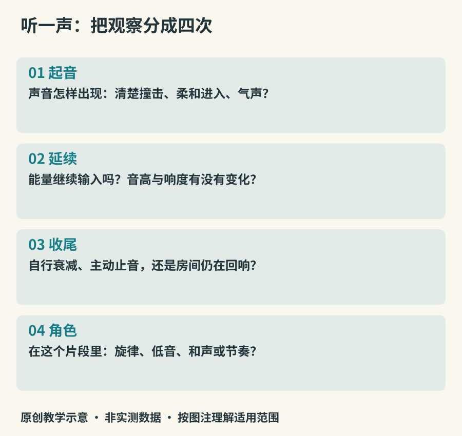

# 从一声开始：怎样观察乐器

一把吉他可以轻轻拨出一个音，也可以扫出一片和弦；小提琴既能拉长音，也能拨弦。认识乐器，先别急着用“悠扬”“浑厚”概括它。那些词能表达感受，却很难解释声音为什么如此，也很难帮助我们在下一次合奏中找到它。

本书使用三个相互连接的问题：什么在振动，演奏者怎样给它能量，这个声音在音乐里做什么。第一个问题通向发声原理，第二个通向演奏方法，第三个通向合奏和文化场景。同一种乐器在三个问题中会得到不同答案。例如钢琴有键盘，用琴槌击弦，能同时承担旋律、低音和和声。

*图1：原创观察路线。先听时间变化，再判断音色与角色；路线是本书的学习方法，不是听觉处理的生理模型。*

## 先听开头，再听中间与结尾

把注意力放在一个音的前半秒。钢琴往往有清楚的撞击开头，随后能量逐渐衰减；拉弦乐器可以在发声后继续供能，甚至让声音逐渐增强。这里比较的是一种常见奏法，而非乐器不可改变的性格。小提琴的拨弦同样会迅速衰减，管乐也能用舌头做出短促的起音。

接下来听声音是否保持平稳。长音可能伴有周期性的音高摆动，常称音高颤动（vibrato）；弦乐可通过揉弦形成这种效果；也可能主要是响度起伏。听不清时，先用“音高在变”“响度在变”描述，不必马上替它贴上技法名称。最后听收尾：手指离开键盘是否立即止音？钹停止敲击以后是否仍在响？演奏者按住鼓面又有什么变化？

开放大学的[听觉入门课程](https://www.open.edu/openlearn/history-the-arts/discovering-music-through-listening)把音色、力度、织体与节奏等作为可分别观察的音乐要素。初学听辨时可以轮流关注它们，不要求一次听全。

## “亮”和“高”是两件事

同一个音高，仍可能有不同的明亮程度。某个低音带着强烈的高频成分，听起来可以很亮；某个高音如果音色柔和，也未必刺耳。“厚”可能来自低频、多个声音叠加、房间混响或演奏力度，并没有唯一对应的结构。

辨认时最好保留四列记录：起音、延续、音色线索、疑问。比如“短而清楚—快速衰减—有金属余响—可能是钟琴，也可能是电子音色”。允许保留候选，比凭一个形容词猜中名称更有价值。随着阅读，你会知道哪些候选在结构上接近，哪些只是录音处理使它们相像。

## 看演奏者的手，也看没有动的地方

一只手按住弦，另一只手拨动弦，通常分别负责选音与激励；但古筝左手在琴码另一侧按弦，又能改变张力，使已经发出的音继续发生变化。管乐手按键并不是直接把金属按键“敲响”，而是在改变管内空气的工作条件。架子鼓手踩踏板，可能控制底鼓击槌，也可能控制踩镲的开合。

观看演奏视频时，每次只追踪一种动作：哪个动作让声音开始，哪个改变音高，哪个让它结束。不要仅根据手速判断难度；保持均匀的长音、控制极弱的起音、和别人同时收尾，都可能很难。

## 一个真实的旁听入口

大都会艺术博物馆的[一件近现代琵琶藏品页](https://www.metmuseum.org/art/collection/search/505247)附有吴蛮2016年的现代琵琶演奏《阳春白雪》。这份音频展示的是现代乐器演奏，不是该件旧藏在原来年代的声音。旁听时先寻找快速重复的颗粒，再听较长的音怎样延续；暂时不要求识别全部指法。

本书不会用一段录音决定整个乐器家族的音色。演奏者、音区、奏法、场地与录音都会改变结果。每章的案例是一扇观察窗口。读完以后，你应当能提出更具体的问题，而不仅是记住更多名字。

## 五分钟的第一次观察

选一段你熟悉的器乐录音，只截取或反复播放其中十秒。第一遍只跟随最醒目的旋律，第二遍找最低的持续声音，第三遍听每次声音出现的边缘。写下一个确定观察和一个待验证猜想。最后找有画面的同一演奏，检查自己的判断。

这项练习不需要买乐器，也不要求“天生有乐感”。当你开始区分“我听到了什么”和“我认为它是什么”，认识乐器的工作就已经开始。
