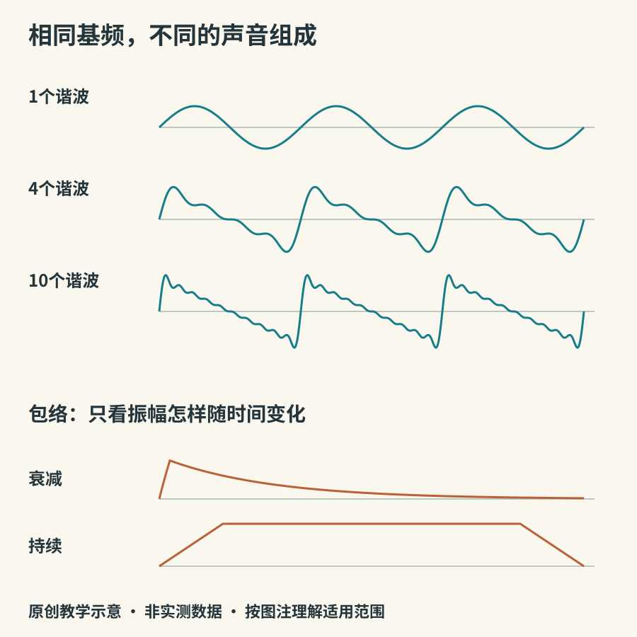

# 振动、音高与音色

弦在抖动，鼓面在起伏，管内的空气在往复变化。这些局部振动通过空气传播到耳边，才成为听到的声音。空气不是一小团从乐器跑到听众耳朵里的物质；主要传递的是压强扰动与能量。[OpenStax关于声波传播的教材](https://openstax.org/books/university-physics-volume-1/pages/17-2-speed-of-sound)给出频率、波长与传播速度的关系：传播速度等于频率乘以波长。

## 音高不是音量

频率表示每秒重复多少次，单位是赫兹。对简单的周期声音，频率越高，通常听起来音高越高。常用的参照音A4可设为440 Hz，但演奏团体也可能采用别的参照，不能把440理解为自然界规定的唯一标准。

振幅描述变化幅度，和响度有关，却不能直接等同于人的响度感受。耳朵对不同频率的敏感程度不同，持续时间和听音环境也参与其中。因此不能看两个波形“画得一样高”，就断定它们听起来一样响。本书音频使用保守的峰值归一化，比较前仍应自行调到舒适音量。

*图2：原创数学示意。上部控制基频，只改变叠加成分；下部控制载波，只比较包络。不是任何真实乐器的测量波形。*

## 一个音里面还有其他频率

如果一个振动严格周期性重复，它可以分解成基频和整数倍频率的成分。假定基频220 Hz，第二、第三谐波在这个理想模型中就是440、660 Hz。不同谐波的强弱改变了音色。真实弦的刚度、碰撞以及非线性行为，又会让实际情况偏离最简模型。

“泛音”和“谐波”也不完全同义。泛音泛指基音以上的分音；只有与基频形成整数倍关系的成分才属于谐波系列。钟和鼓会出现许多非整数倍关系的振动模式，仍然可以构成丰富、可辨认的音色。参见UNSW对[谐波与实际振动的说明](https://www.phys.unsw.edu.au/jw/harmonics.html)。

看频谱可以帮助观察，但音色还在时间中变化。同样一组频率，突然出现、缓慢出现，或高频先消失，感受都可能不同。声学研究中，[频谱](https://www.phys.unsw.edu.au/jw/sound.spectrum.html)展示各频率成分的强弱；它是一张切面，不是声音全部性格的身份证。

## 共鸣为什么重要

单独一根细弦移动的空气不多。琴桥把振动传给更大的琴体，面板和腔内空气参与运动，让声能更有效地辐射出来。共鸣并不是无中生有地增加能量；它改变传递效率、频率分布和能量释放速度。UNSW的[乐器与音乐信号导论](https://phys.unsw.edu.au/jw/musical-sounds-musical-instruments.html)解释了弦、琴体与空气之间的这种协作。

我们常把“共鸣箱”想象成统一放大一切的箱子，实际它会对不同频率作不同响应。因此两把外形接近的乐器仍可能有可听差异。不过，材料名称也不能单独预测成品声音：形状、厚度、装配和演奏方式都在参与。

## 两个不拆乐器的观察

先轻哼一个持续音，用手指轻触喉部，可以感到振动；把嘴从“乌”改成“啊”，保持音高大致不变，音色仍会变化。这里声道的形状改变了滤波条件。它只能帮助理解“声源加响应”，不表示人声与每种管乐都采用同一机制。

再听本书`assets/audio/01-harmonics.wav`：三个片段都以220 Hz为基频，依次是单一正弦、少量谐波与较丰富的谐波。听完`02-envelope.wav`，比较短起音衰减与持续包络。不要猜乐器名称；这些是人为控制变量的合成实验，没有模仿特定乐器。

声学知识在这里的作用，是让听觉问题更清楚：你听到的差异来自基频、频率组成，还是声音随时间变化？带着这个问题，再去认识弦、管、膜与电子声源，就有了共同的起点。
