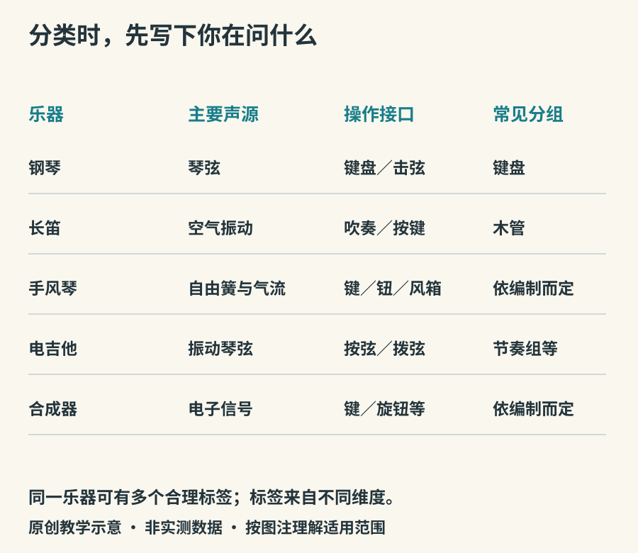

# 分类地图与流动的历史

博物馆把钢琴放进弦鸣乐器，音乐会节目册把它叫作键盘乐器，课堂又会说它通过敲击发声。三个说法可以同时成立，因为它们回答的是不同问题。分类的价值在于让比较清楚；一旦忘了分类依据，就会把合理的不同答案当成矛盾。

## 三张重叠的地图

第一张地图按主要声源分组。本书采用体鸣、膜鸣、弦鸣、气鸣与电子声源的入门框架。霍恩博斯特尔—萨克斯体系及其后续修订，提供了比这复杂得多的细分规则。[ICOM MUSIC分类资料入口](https://icom-music.mini.icom.museum/resources/classification-of-musical-instruments/)列有2011年修订版及2017、2021年补充。这里的五组是教学入口，不代替逐器种的完整编码。

第二张地图按演奏接口分：键盘、吹奏、拉弦、拨弦、击奏等。第三张地图按具体乐队惯例分：木管、铜管、弦乐、打击乐、节奏组。金属长笛属于现代交响乐队的木管组，萨克斯也不会因为金属外壳就变成铜管；关键是演奏传统与发声结构，而非材料名称。

*图3：原创多维分类对照。表中的“电子声源”是入门描述，电声细分应另查完整分类，不把所有插电乐器一概而论。*

中国传统“八音”使用金、石、土、革、丝、木、匏、竹等材料名称组织乐器。它属于自己的历史思想与礼乐语境，不宜简单评价为现代体系的低级版本。琵琶使用丝弦的传统与其分类的关系，可见大都会博物馆的[琵琶专题](https://www.metmuseum.org/essays/the-pipa)。今天换成金属或复合材料弦，也不会自动抹掉这个历史。

## 保存下来的，不等于最早出现的

石、骨和金属较容易留下实物；木、皮、植物茎秆较容易腐坏。考古发现的早晚同时受保存条件和发掘范围影响。因此，一件很早的骨笛只能证明那个时空已有相关制器与音乐行为，不能证明人类此前没有击掌、歌唱或使用易腐材料。

中国国家博物馆的[贾湖骨笛藏品说明](https://www.chnmuseum.cn/zp/zpml/kgfjp/202008/t20200824_247261.shtml)介绍了裴李岗文化时期的鸟骨笛及不同孔数的发现。观察重点可以放在制作者已经在骨管上安排孔洞、形成可控制的多音结构，而不是把它直接解释成现代某套调式的完整起点。

## 乐器常常沿着人群移动

迁徙、贸易、宗教仪式、殖民经历、宫廷与城市娱乐，都可能改变一种乐器的去处。它到了新地方以后，也可能改弦、改奏法、改乐队位置。因此“来自哪里”通常需要分成器形来源、名称来源、当地发展与今天的身份几个层次。

大都会博物馆的一件[明代晚期至清初琵琶](https://www.metmuseum.org/art/collection/search/503651)介绍了梨形鲁特类乐器向中国传播、持琴姿势和拨奏方法变化的脉络。这类案例提醒我们：交流不会让地方传统失去独特性，长期改造本身就是传统形成的一部分。

## 技术变化也有社会条件

更大的演出空间会带来投射声音的需要；复杂的转调可能推动指孔、按键和阀键的改造；电扩声又允许较轻的演奏动作被大量观众听见。但历史不是所有乐器最终都朝“更响、更准、更复杂”进化的一条直线。安静的室内独奏、仪式中的固定音型与社区合奏，可能有完全不同的目标。

看一件乐器时，可以试着写两份说明：一份只写材料、形状、声源和操作；另一份写谁演奏、在哪里、为谁而奏。前者帮助理解机械与声学，后者提醒我们，乐器也承载人的关系。两份说明合起来，才接近一件乐器的生活。
