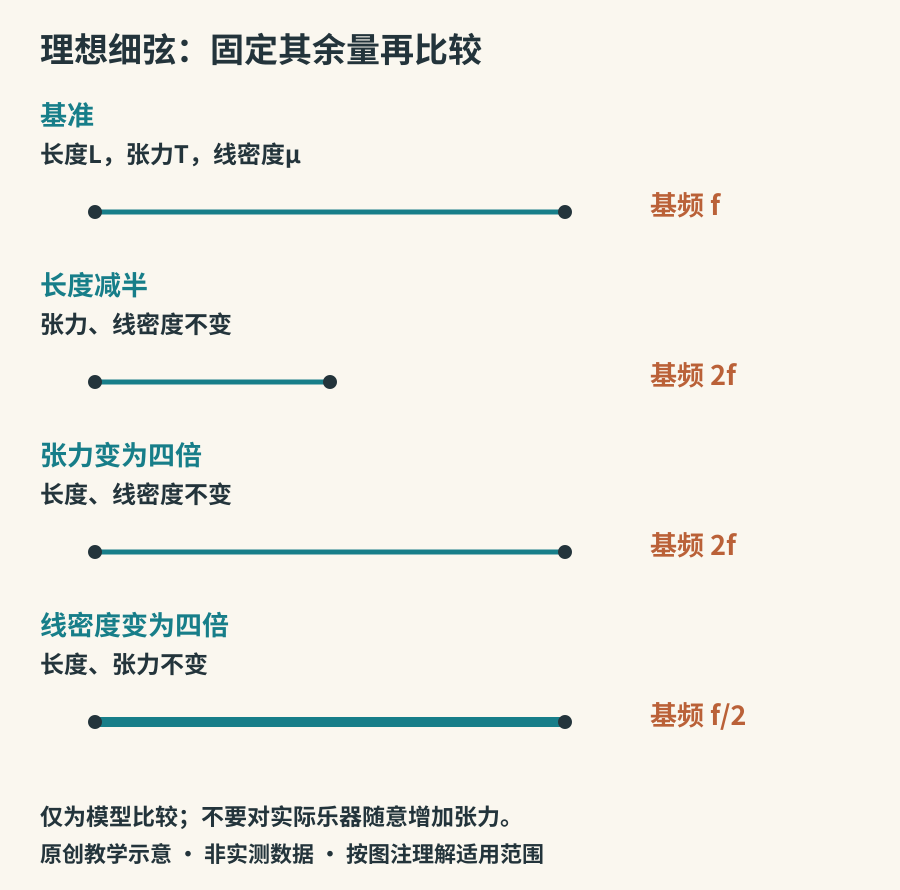

# 一根弦怎样唱歌

把一根弦绷在两端，轻拨一下，它就能来回运动。但“有振动”和“成为好用的乐器”之间，还隔着稳定的音高、可控的奏法、有效的声音辐射与方便的选音方式。弦乐器之间的差异，大多沿着这几条线展开。

## 三个变量：长度、张力、每米多重

理想的细软弦，两端固定时，基频可以近似写作：

**f₁ = (1 / 2L) × √(T / μ)**

这里L是有效振动长度，T是张力，μ是单位长度质量。固定另外两个量，缩短弦长会使音升高，增加张力也会升高，增大单位长度质量则会降低。不是所有真实琴弦都完全符合模型；刚度、琴桥条件与振幅会带来偏差。公式及驻波说明见UNSW的[弦与谐波](https://phys.unsw.edu.au/jw/strings.html)。

*图4：原创理想弦模型，所有比较均固定其余条件。图中的比例是公式推导，不是实测乐器数据；增张力不是让读者把实际琴弦任意拧紧。*

这解释了几种日常现象：左手按弦常常缩短有效长度；调音弦轴改变张力；低音弦往往更粗，或通过缠绕增加单位长度质量。低音乐器也可以同时采用更长的弦。不要只看某一条弦粗细，就推断所有乐器的音高关系。

## 同一根弦不只以一种方式运动

理想弦的第一模式中间振动明显，两端不动；第二模式中间也有节点，弦分成两个相反起伏的部分。更高模式继续增加分段。所谓节点，是该模式中位移很小或为零的位置；把几个模式叠加起来，弦的瞬时形状会更复杂。

轻触某些位置而不把弦压在指板上，可以抑制部分模式，得到泛音。它与正常按实后的短弦发音不同。OpenStax的[驻波与共振](https://openstax.org/books/university-physics-volume-1/pages/16-6-standing-waves-and-resonance)适合进一步看节点、腹部与模式的关系。实际泛音奏法则应按乐器与老师的指导操作，不能把任意位置都当成稳定泛音点。

## 能量怎样进入弦

拨弦：先让弦偏离平衡位置再放开，主要是一开始输入能量。击弦：琴槌或琴竹撞击，接触过程决定了声音的开头。拉弦：弓毛与弦的摩擦在运动中持续输入能量，形成黏着与滑动交替的行为。这些不是绝对的单一波形，但足以解释为什么拨弦音常逐渐衰减，而弓弦长音可以持续发展。

拨弦位置也会影响各模式的激发程度。靠近琴桥拨奏往往更尖、更亮，靠中间则可能更圆润；同时响度、手指软硬、指甲与拨片也会参与。控制变量时应只改一个因素，而不要把拨的位置、力度、用具一次全部换掉。

## 琴桥不是简单支架

弦的能量经琴桥传给琴体。琴桥的位置、质量与接触状态会影响这种耦合，琴体又有自己的响应。原理上这是把弦与更有效的辐射结构联系起来；它不意味着更大的箱体一定更好，或只要用贵重木材就有确定的音色。[UNSW吉他声学导论](https://newt.phys.unsw.edu.au/music/guitar/)展示了弦、琴桥、面板与空气的联系。

## 观察而不拆装

如果手边有吉他，先弹一根空弦，等声音衰减后再弹同弦第十二品，听近似一个八度的关系。再比较同一空弦靠近琴桥与靠近指板处轻拨的音色。每次只改变一项，用录音保存结果。没有吉他也可以观看演奏视频，寻找按弦点、琴桥与振动段的相对位置。

橡皮筋可以作粗略的振动示范，但它伸长时，张力和单位长度质量会同时改变，因此不适合用来“验证只改变长度”的公式。理解模型的适用条件，比做出一个看似吻合的结果更重要。
