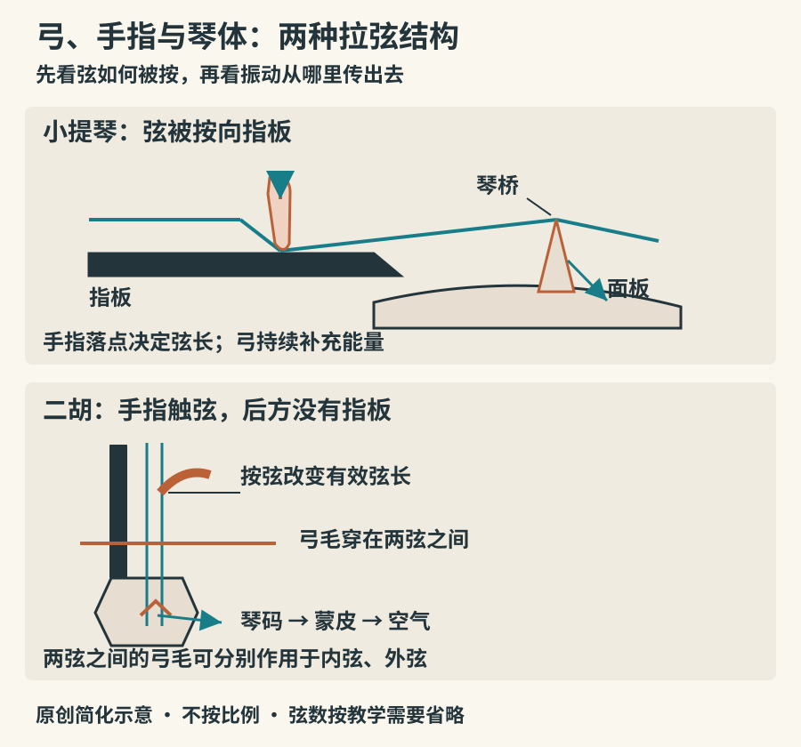

# 拉弦：让声音持续呼吸

小提琴拉出长音时，右手一直在动；把同一根弦拨一下，声音却逐渐消失。区别在于能量怎样进入琴弦。拨弦只在起音时提供主要激励，弓则能不断补充能量。因此，拉弦乐器不仅能把音拖长，还能让一个音在途中变强、变弱，形成近似呼吸的句子。

## 弓不是一把连续摩擦的锉刀

涂过松香的弓毛与琴弦之间会交替发生“黏住”和“滑脱”：弦先随弓移动，随后迅速回滑，再进入下一周期。稳定拉奏时，这种循环受弦的振动制约。弓移动得慢，不代表声音的振动频率低；拉同一个音时，弦可能每秒振动数百次，右手只是在控制能量输入。[新南威尔士大学：弓与弦的黏滑运动](https://newt.phys.unsw.edu.au/jw/Bows.html)

因此，“大力拉就一定响亮”并不成立。弓速、压在弦上的力、接触点三者需要配合。力太小可能抓不住弦，力过大又可能破坏稳定振动，出现挤压或刮擦感。靠近琴桥拉奏通常能获得较强的高频成分，但也要求相应调整弓的控制。听到摩擦声时，先别认定琴不好：它可能来自奏法，也可能是刻意使用的音色。

弦自身推动空气的效率有限。振动经琴桥传到面板，再由琴体与周围空气共同形成可听的声音。小提琴内部的低音梁和音柱参与支撑与振动传递，不能理解为单纯把弦声“装大”的空盒子。[Yamaha：小提琴怎样发声](https://www.yamaha.com/en/musical_instrument_guide/violin/mechanism/mechanism004.html)

*图05：原创简化结构示意。上部为小提琴局部侧视，下部为二胡示意；弦数及外形有所省略，不是尺寸图。二胡琴弦没有被压到指板上，弓毛穿在两弦之间。*

## 小提琴、中提琴、大提琴：相似结构，不同岗位

小提琴族以琴体尺寸、弦长与定弦的差异形成不同音区。小提琴常用四根弦，由低到高为G、D、A、E；中提琴通常为C、G、D、A；大提琴通常比中提琴低一个八度。这里的字母表示音名，具体八度记法见记谱章节。它们都能演奏旋律、和声及节奏性织体，不能只用“高音负责旋律、低音负责伴奏”分工。

小提琴与中提琴通常架在肩部，大提琴由坐姿、双腿与尾柱共同稳定。三者一般没有吉他式的品格，左手落点需要听觉与肌肉控制配合。按弦位置改变有效弦长，换到较高把位后，相邻音的距离缩短，手指间距也必须改变。[Yamaha：小提琴基本演奏姿势](https://www.yamaha.com/en/musical_instrument_guide/violin/play/)

低音提琴虽然常与它们组成弦乐声部，历史和形制更复杂，不宜只说它是放大的大提琴。常见四弦低音提琴按四度定弦，弦乐队中的其他上述乐器通常按五度定弦。管弦乐中它能支撑和声与节奏；爵士乐里，拨奏的低音线也常成为推动音乐前进的骨架。英国爱乐乐团的演示可直接观察乐手怎样在拉奏与拨奏之间转换。[Philharmonia：低音提琴](https://philharmonia.co.uk/resources/instruments/double-bass/)

## 从旧琴看到制作传统

欧洲小提琴的成熟与十六世纪北意大利制琴活动关系密切，克雷莫纳的阿马蒂家族是重要线索。大都会保存的安德烈亚·阿马蒂小提琴，附有在该琴上演奏的录音；可以把“看一件历史实物”和“听它在今天怎样发声”连起来。它说明乐器历史也包含不断延续的制作与演奏实践，而不只是名家年代表。[The Met：阿马蒂小提琴及演奏录音](https://blog.metmuseum.org/guitarheroes/violin-ca-1559/)

比较历史演奏与现代演奏时，还需留意琴弦、弓和演奏习惯可能变化。照片里的旧琴并不自动等于古人当时听到的全部声音。

## 二胡的两根弦为什么已经够丰富

二胡通常有两根弦，常用定弦为D、A。琴筒一端蒙膜，琴码坐在膜上；左手按弦时，弦的后面没有小提琴那样的指板。弓毛穿在两弦之间，演奏者改变接触方向，使它作用于内弦或外弦。这些结构差异会影响触弦感、换弦方法和滑音的组织。[Grinnell College：二胡实物与演奏说明](https://omeka-s.grinnell.edu/s/MusicalInstruments/item/645)

弦少并不意味着音少。左手可在弦上移动，改变音高；同一根弦上又能通过揉弦、滑音和弓法产生许多细微变化。二胡、京胡、高胡属于相关却不相同的胡琴：尺寸、材料、定弦和戏曲或合奏语境均有差别。不要凭“有琴筒、两根弦”就把它们统称为二胡。

二胡的早期历史存在文献与形制解释上的复杂问题。从历史胡琴到现代音乐会二胡，也经历了演奏、教材和曲目的发展。博物馆所藏旧琴可以证明某种结构在某时存在，不能单靠一件藏品宣布今天的二胡由某人在某年完整发明。耶鲁大学馆藏可供比较琴杆、琴筒及弓的位置。[Yale School of Music：二胡馆藏](https://music.yale.edu/browse-collection/erhu-45031973)

## 把听辨焦点从“像人声”移到具体动作

拉弦声经常被形容为像歌唱，但这个比喻不足以辨认乐器。先听音头：是否有短促的弓擦声？再听持续阶段：音量能否明显增长？最后听两个音的连接：是清楚分开，还是音高滑过去？这些特征反映的是发声与奏法，未必属于某一种乐器独有的指纹。

同一把小提琴可以拉奏，也可以拨奏，即乐谱中的 *pizzicato*；拨奏并不会把它变成另一种结构类别。马提琴、板胡等其他拉弦乐器也各有自己的声音和传统。本章建立的是比较方法，不是把世界拉弦乐器压缩为两大体系。

做一次短练习：在英国爱乐乐团的低音提琴演示中，分别记录拉奏和拨奏的音头、延音与尾音；再听一段二胡独奏，只描述“哪里换了弓、哪里滑了音”，暂不写“悲伤”“悠扬”。前者是可重复观察的声音线索，后者是听者的感受。两者都重要，但应分开。

## 实物观察与上手界限

借到乐器时，可以观察琴桥是否直立、弓与弦的接触位置，以及演奏者左手是否把弦压向指板。初次体验拉弦宜由教师协助设置姿势和弓毛张力；肩颈紧绷、拇指夹死，通常需要停下来调整。弓毛不靠手摸来判断松香多少，也不要自行移动音柱或琴桥。掌握“能持续输入能量”和“能连续改变音高”这两个特点，已经足以理解拉弦乐器很大一部分表现力。
