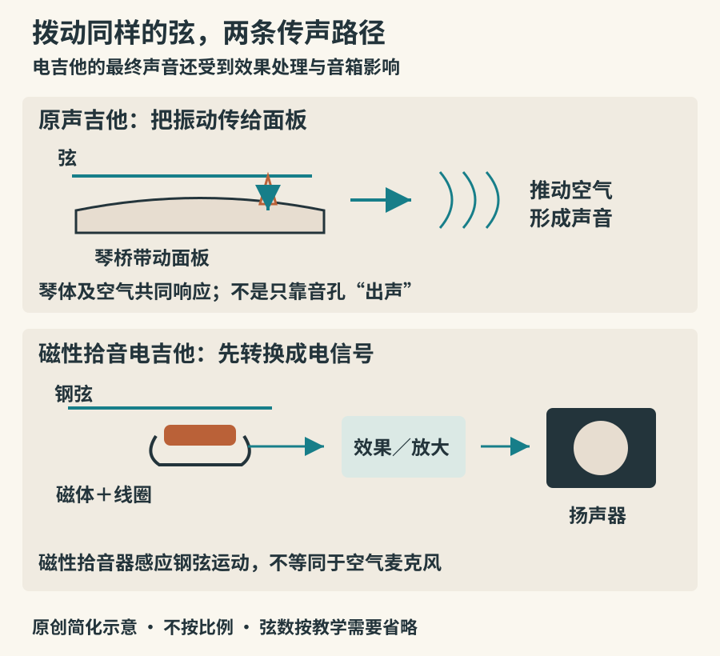

# 吉他与电贝斯：拨弦的不同去向

在咖啡馆、摇滚舞台和室内独奏会里，都能看到吉他。它们轮廓相似，却不只是同一把琴换了外壳。弦的材料、琴体的传声方式、拾音与扩声、演奏习惯共同决定了声音。先问“弦怎样振动，振动怎样变成我们听到的声音”，比先背型号更有用。

## 指板上的品，规定了怎样的音高关系

空弦的主要振动段位于上弦枕与下弦枕之间。左手把弦压到某个品上，振动段的起点移到该品，弦长缩短，音高上升。现代常见吉他的相邻品通常对应十二平均律的一个半音，品距向琴体方向逐渐缩小；这是同样的音程比例对应越来越短的弦长。[Yamaha：弦长与音高](https://www.yamaha.com/en/musical_instrument_guide/acoustic_guitar/mechanism/mechanism003.html)

手指一般按在品的后侧、接近品丝的位置，而非正好压住品丝。按得太远可能需要额外用力，按得过猛又可能把音拉高。每根弦有许多音，许多音也能在不同弦上找到；相同音高换一根弦，音色和连接方式可能改变。

*图06：原创传声路径示意。磁性拾音器以线圈和磁体简化表示；木吉他也可以另装拾音系统，电吉他也存在空心及半空心结构。两条路径并非互斥的产品清单。*

## 古典吉他、钢弦木吉他与电吉他

古典吉他常用尼龙类高音弦与绕弦低音弦，琴颈通常较宽，便于手指独立拨奏。低音弦看上去是金属，并不代表整套弦与钢弦木吉他相同。音色常有较圆润的起音，但指甲形状、触弦位置和奏法能显著改变结果。古典吉他也能演奏爵士、流行和巴西音乐，名称不等于曲风限制。[Yamaha：古典吉他的弦与琴颈](https://www.yamaha.com/en/musical_instrument_guide/classical_guitar/mechanism/mechanism002.html)

日常中文说的“民谣吉他”多指钢弦原声吉他的一些常见形制，并不是严格涵盖全球民间吉他的分类。它用琴桥带动面板振动，琴体和音孔附近的空气也参与声学响应。钢弦的触感、张力与音头和古典吉他不同，但不能据此把所有钢弦琴都判为响亮、所有尼龙弦琴都判为柔和。

电吉他常用磁性拾音器：钢弦在磁场中振动，线圈产生相应的电信号。信号再经过音量音色控制、效果处理与放大，由扬声器发声。拾音器通常不是把空气里的琴声“录进去”的小麦克风；压电拾音等其他方案另有工作方式。[Yamaha：拾音器是什么](https://www.yamaha.com/en/musical_instrument_guide/electric_guitar/mechanism/mechanism002.html)

因此，电吉他的声音要沿整条链观察。失真、压缩、延迟和混响都能改变声音的时间和频谱特征。延音很长，不一定说明琴弦本身衰减很慢；它可能经过压缩、失真或声反馈。清音与重失真也不是两件不同种类的乐器，而可能只是同一把电吉他的不同设置。[Yamaha：效果器的作用](https://www.yamaha.com/en/musical_instrument_guide/electric_guitar/play/play004.html)

## 历史里的改变，往往回应实际需求

吉他的现代形制经过长期变化。十九世纪西班牙制琴师安东尼奥·德·托雷斯对古典吉他的琴体及结构发展影响显著；后来电吉他的发展又把声音输出的一部分任务交给拾音与扩声系统。两者都在回应演奏需求，却不构成“电的先进、原声的落后”这种等级。[Yamaha：古典吉他的形制发展](https://www.yamaha.com/en/musical_instrument_guide/classical_guitar/structure/)

比较录音时，先核对是独奏、伴唱还是乐队演奏。承担不同岗位的乐器，往往会采用不同音色与奏法；不能只靠一段录音判断某一类琴“只能弹什么”。

## 贝斯为什么不能只听最低的声音

常见四弦电贝斯由低到高定为E、A、D、G，比吉他最低四弦低一个八度；五弦、六弦和无品贝斯也很常见。它常与鼓共同组织节奏，同时用低音线交代和声走向。真正的贝斯声部并不总在最低音区不动，也能形成旋律、切分和对位。

手指拨弦、拨片与拍击会产生不同的音头。拍击中的拇指击弦、手指勾弦，能把弦的撞击成分突出出来。听辨时可以先跟着每个音的起点打拍，再注意它何时停止：干净的止音与准确的起音一样重要。[Yamaha：电贝斯的几种演奏方式及声音演示](https://www.yamaha.com/en/musical_instrument_guide/electric_guitar/play/play005.html)

若在混音里听不见贝斯，不必立刻调大低频。试着注意中低音区的拨弦轮廓，或在耳机与合适的音箱之间换听；播放设备、房间和编曲都可能掩盖它。只依赖手机扬声器判断最低音，容易把“设备没播出来”误认为“演奏中没有”。

## 乌克丽丽：短小乐器也有自己的历史和逻辑

乌克丽丽与十九世纪晚期夏威夷的乐器文化、葡萄牙移民带去的相关小型拨弦乐器有联系。今天的高音、音乐会型、次中音及低音型，在尺寸和常用定弦上并不完全相同。Grinnell 的馆藏说明提供了可供进一步追溯的历史与形制资料。[Grinnell College：乌克丽丽](https://omeka-s.grinnell.edu/s/MusicalInstruments/item/2115)

常见G—C—E—A定弦可以采用高G：看似最靠上的一根弦并不是四弦中最低的音。这种“回返式定弦”会影响和弦音的排列。也有低G设置和其他定弦，因此不要把吉他最细的四根弦或它们的和弦指型直接搬过来。小琴身有利于携带，却不意味着所有人的手指都更容易放下；短品距也可能让某些指型拥挤。

## 用三次拨弦听懂音色

如果能借到一把状态正常的琴，先请熟悉的人调好音。选一根空弦，做三次相近力度的拨奏：靠近下弦枕、靠近音孔中部、靠近指板末端。通常能听到音头与明亮程度变化。接着在同一位置分别用指腹和拨片试奏，观察“材料改变”与“位置改变”带来的区别。电吉他可在清音、相近音量条件下重复实验，再切换拾音器，避免把更响误判为更好听。

没有乐器也能完成比较：使用本章官方贝斯演示，先听空弦与单音，再听拨片和手指示范。第一次只判断音头，第二次只判断尾音，最后才描述整体风格。这比把所有吉他声归为“清脆”、所有贝斯声归为“低沉”更接近真实演奏。

初次上手应先学轻松的单音和止音，不必立刻挑战大横按。琴弦规格必须适合乐器设计，尤其不要把钢弦直接换到原为尼龙弦设计的古典琴上。手指疼痛、弦距异常或持续打品，应检查姿势和乐器状态；靠不断加力解决所有问题，只会让练习更困难。
