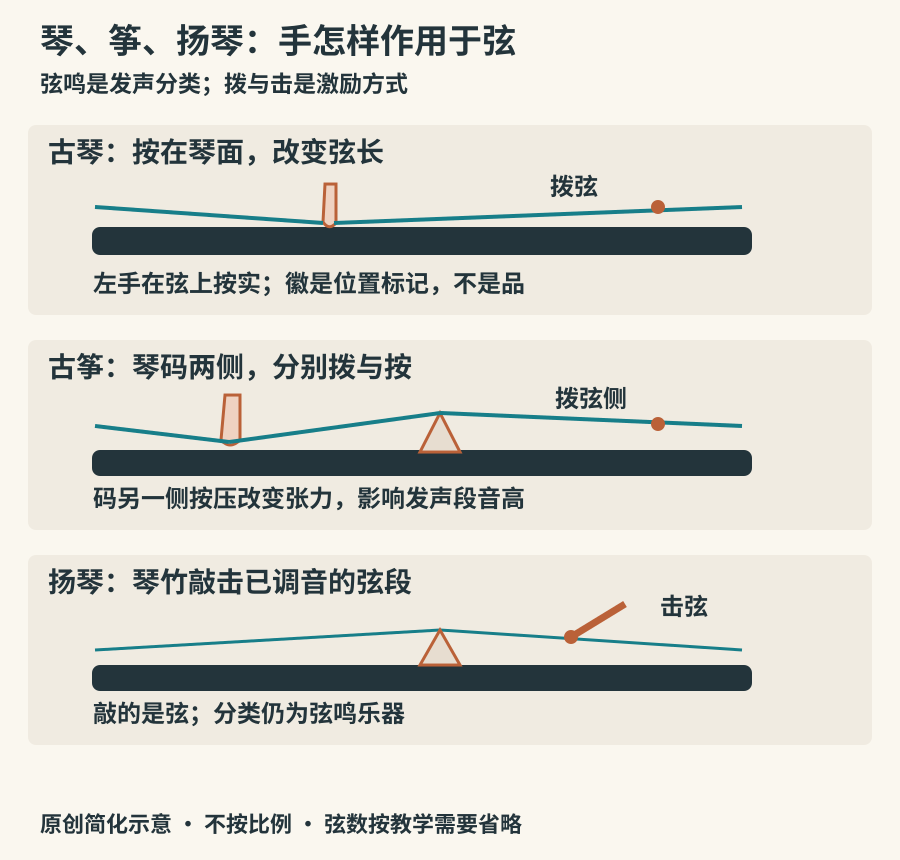

# 琴筝琵琶与扬琴：弦上的分岔

古琴与古筝都平放，都有长长的弦；琵琶与阮都有琴颈和共鸣箱；扬琴也常出现在弹拨声部附近。仅凭演出编制，很容易误以为它们的发声方式相同。比较时先找三个位置：弦在哪里受到激励，哪里确定有效弦长，振动通过哪里传到共鸣体。

## 古琴：同一根弦上的三种声音

现代常见古琴为七弦，面板上没有古筝那样逐弦安放的可移动琴码。散音是拨奏空弦；按音由左手把弦按在琴面上，右手拨弦，左手还可移动产生走音；泛音则用左手在特定位置轻触弦，右手拨弦，突出一组较高的振动成分。这三种方式在触感、音色和音乐语法上各有用途。[UNESCO：古琴艺术及基本奏法](https://ich.unesco.org/en/RL/guqin-and-its-music-00061)

十三个“徽”是位置标记，不是把弦顶起来的品。古琴演奏也不是依次按十三个固定音键：按音位置远不止十三处。散音、按音、泛音交替时，听者会感到声音在开阔、凝聚和轻盈之间变化；余音中的滑动也是乐句的一部分。

古琴常与文人修养联系，但这是一段具体社会历史，而非所有演奏者必须接受的性格标签。大都会博物馆藏十七世纪晚期至十八世纪中期古琴，保存了材料与形制资料，页面还提供现代古琴演示《关山月》。先听每次拨弦后是否还有音高移动，再看左手，能把抽象的“韵”落实为动作。[The Met：古琴，藏品2011.586及音频](https://www.metmuseum.org/art/collection/search/506800)

## 古筝：琴码把一根弦分成两个工作区

古筝最明显的识别点，是每根弦下方有可移动琴码。常见二十一弦筝只是现代常用形制之一，历史及其他当代型号并不止这一种。弦的一侧主要用于拨奏，另一侧可以按压改变张力，影响发声段的音高；琴码的位置也参与调弦。演奏者通常右手承担许多拨弦动作，左手处理按、滑、揉等变化，但现代演奏可以双手参与拨奏。[Grinnell College：筝的琴码与演奏结构](https://omeka-s.grinnell.edu/s/MusicalInstruments/item/1833)

*图07：原创结构原理示意。每排只画少量弦或一根弦，方向统一为便于比较的示意方向，不替代实际坐姿。琴的按弦、筝的码旁按压、扬琴的击弦是三种不同动作。*

筝的刮奏很容易辨认，却只是奏法之一。判断一段筝乐，不应只等连续扫过许多弦的声音；单音后的上滑、颤动和按压回落，常更能说明它怎样组织旋律。不同地域流派在曲目、左手处理和节奏气质上有所区别，也不能拿一种地方风格概括全部筝乐。

## 琵琶与阮：从轮廓看支点，从音头听手指

现代常见琵琶为四弦，梨形琴身，琴颈及面板上有用于按弦的相、品。弹、挑、轮指及多种扫拂动作，可以组织密集的音头。听到仿佛持续不断的长音时，细听它是否由快速重复拨弦构成；轮指和弓的持续供能不是同一回事。

琵琶的历史不能缩成一条“某国乐器传入后原样保存”的直线。“琵琶”在古代还曾用于称呼相关拨弦乐器；梨形曲项乐器经中亚交流进入中国后，持奏姿势、拨弦工具及演奏体系继续变化。大都会一件明代琵琶的介绍指出，从较横的持琴与大拨子，到更直立的持琴与手指演奏，存在逐步发展的过程。[The Met：明代琵琶及形制演变](https://www.metmuseum.org/art/collection/search/503651)

该藏品页面附吴蛮演奏现代琵琶《阳春白雪》的音频。把注意力放在轮指与清楚的单次拨弦之间的切换，再听密集声响如何停下来，便能避免把琵琶只理解为“声音很快的乐器”。这段现代演示不代表藏品本身正在被演奏。

阮的圆形琴身、较长直颈和品格，提供了另一套辨认线索。现代民族乐队常见中阮、大阮等不同规格，用于旋律、分解和弦、节奏和中低音支撑。圆身不等于月琴：阮与月琴在琴颈长度、结构及使用传统上存在差异。观察实物时，把琴身与琴颈一起看，比只记“圆形”可靠。[不列颠哥伦比亚华乐协会：阮](https://www.bccma.net/instruments/ruan/)

## 三弦与扬琴：蒙皮不等于鼓，敲击不等于体鸣

三弦通常有长而无品的琴颈，三根弦和蒙皮共鸣体。拨弦后由琴码把振动传向蒙皮，共鸣材料会参与音色形成，但首先被拨动的仍是弦，因此它属于弦鸣乐器。说唱伴奏中的三弦常围绕唱腔组织，具体定弦与奏法要看地域和体裁。[The Met：三弦，约1900年，藏品44.51.1](https://www.metmuseum.org/art/collection/search/505692)

扬琴则用琴竹击弦。琴身上成组金属弦跨过琴码，演奏者通过不同击弦位置选择音高，以左右手交替、轮奏等方法组织旋律和织体。它既不是古筝换了两根小棍，也不是“敲木头就发音”的木琴。扬琴虽常编入民族乐队弹拨声部，从激励方式说却是击弦乐器。[The Met：广州扬琴及传播线索](https://www.metmuseum.org/art/collection/search/500595)

上述馆藏说明将中国扬琴的早期传播线索联系到明代广东及海上交流。这是基于现有证据的历史解释，不表示整个中国弦乐史都沿同一条路线发展。不同乐器在礼仪、戏曲、说唱、民间合奏和现代舞台之间反复交流，今天的乐队分组只是它们历史中的一层。

同一类乐器也可能使用不同材料与现代改良结构。认出名字之后，仍应看清这一次演奏的是哪一种形制；乐队里的统一规格，不能代替地方音乐长期形成的多样性。

## 一张纸也能做结构比较

画三根横线，分别代表古琴、古筝与扬琴的一根弦。古琴线上标“左手按点”；古筝线上先画一座码，再在码的另一侧标“按压”；扬琴线上画“琴竹击弦点”。然后回答：音高改变是靠手指确定弦长、靠按压改变张力，还是主要由所击弦段的预先调弦决定？这不是完整声学模型，却能帮助厘清三者的主要操作逻辑。

最后回到声音：听古琴演示时留意一个音的余韵，听琵琶演示时数一串音的起点，观看扬琴演奏时追踪两只手怎样轮流工作。乐器身份既在轮廓里，也在动作及声音的因果关系里。
