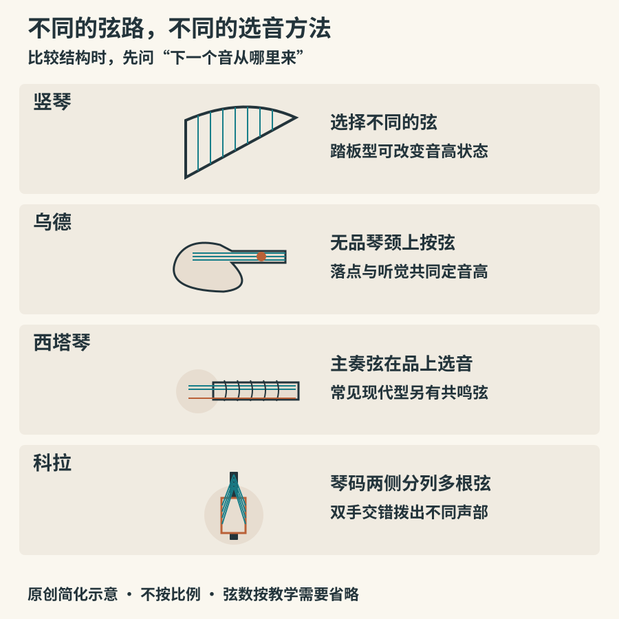

# 竖琴、乌德、西塔与科拉

“世界乐器”不是把某地音乐放在书末当作异国点缀。观察不同地区怎样布置琴弦、改变音高、传递技巧，能检验前面学过的分类是否真的有用。本章选择四条互不等同的传统：欧洲音乐会竖琴、西亚与邻近地区的乌德、北印度斯坦音乐中的西塔琴，以及西非曼德文化地区的科拉。它们不能代表所在地区的全部音乐。

## 竖琴：一根弦一个主要音高，脚也参与演奏

竖琴的弦平面与音板形成夹角。演奏者通常不把每根弦按在指板上，而是拨不同的弦选择主要音高。现代音乐会双动作踏板竖琴常有四十七弦、七个踏板；每个踏板控制同名音的弦，使演奏者能在演奏中改变它们的音高状态。并非所有竖琴都有踏板，小型拨杆竖琴和其他形制需另作比较。[Philharmonia：音乐会竖琴及演奏演示](https://philharmonia.co.uk/resources/instruments/harp/)

看到一连串流畅的琶音时，还应注意乐手何时止住不需要的余音，以及脚是否正在换踏板。竖琴并不只是负责“梦境般的扫弦”：它可以奏和弦、旋律、重复节型，也能产生干脆的节奏。作曲若要求频繁半音变化，就必须考虑踏板切换与双手的实际时间。

欧洲踏板竖琴的机械装置是逐步发展的，不能用现代结构解释所有古代竖琴。大都会收藏的Érard竖琴可供观察十九世纪乐器的琴颈、弦列与底部装置；历史藏品与现代演示并看，能发现外形背后不断变化的控制需求。[The Met：Érard踏板竖琴](https://www.metmuseum.org/art/collection/search/503163)

## 乌德：没有品，怎样把音放准确

乌德（oud）常有鼓起的梨形琴背、短琴颈和向后折的弦轴箱，通常没有固定品格。左手落点与听觉共同确定音高；右手常用拨子演奏。弦往往成对组成弦组，具体弦数、尺寸与调弦随地区、流派和个人设置而异。不要把一把馆藏琴的规格当成所有乌德的统一标准。

克利夫兰艺术博物馆所藏十九世纪晚期至二十世纪早期乌德，清楚展示了无品指板及弯折弦轴箱。该馆说明也把乌德联系到法拉比的音乐论述，显示它不只是伴奏工具，还是理论思考与音乐实践的重要对象。[Cleveland Museum of Art：乌德，藏品1918.350](https://www.clevelandart.org/art/1918.350)

无品结构可以支持西方十二平均律之外的音高处理，但这不表示每首乌德音乐都使用同样的“微分音”。旋法、音程、重音和装饰习惯必须放回具体传统理解。初听时可先追踪拨子划过弦组的音头，再听旋律怎样停留、转折和返回，不必急着用熟悉的大调或小调为它命名。

*图08：原创简化原理图。弦数大幅省略，仅用于比较不同的选音方式；西塔琴共鸣弦画在主奏弦下方，科拉画出琴码两侧弦列。外形、比例和定弦不能用于制造或演奏。*

## 西塔琴：主奏弦之外，还有共鸣弦

西塔琴（sitar）与波斯塞塔尔琴（setar）不是同一件乐器。常见现代西塔琴有长琴颈、弧形品及多根弦，其中一部分供主要拨奏，一部分为共鸣弦。主奏弦发声后，调到相关音高的共鸣弦会受到激发，延展声音的背景。弦与弦桥接触方式也参与形成它带有嗡鸣感的音色，不能把全部效果归因于共鸣弦。

具体形制在历史上发生过变化。大都会一件十九世纪中期西塔琴的说明明确指出，它没有现代乐器所见的共鸣弦；因此，“所有西塔琴自古都有很多共鸣弦”是站不住脚的概括。[The Met：早期西塔琴，藏品89.4.190](https://www.metmuseum.org/art/collection/search/500759)

在北印度斯坦古典音乐中，西塔琴可用于展开拉格。拉格并非只有一组可任意排列的音，还涉及重要音、旋律行进与表现惯例。听慢速展开时，可留意一个音如何被推拉、滑动和装饰；进入更有节奏的段落后，再听它怎样与塔布拉鼓互动。英国博物馆保存了拉维·香卡使用过的西塔琴，相关介绍提供了具体演奏者与跨文化传播的历史入口。[British Museum：拉维·香卡的西塔琴](https://www.britishmuseum.org/blog/ravi-shankars-sitar-bringing-india-world)

## 科拉：两只手怎样织出好几层音乐

科拉（kora）与西非曼德文化地区密切相关，特别联系曼丁卡人的贾利（jali）音乐家、歌者与叙事者传统。常见二十一弦跨过高琴码，分列在两侧；共鸣体通常使用覆皮葫芦。演奏者握住支杆，以双手拇指和食指拨弦，组织相互交错的声部。它可以听起来像不止一件乐器，但不必据此假定录音必有叠录。[The Met：科拉的结构、地区与社会功能](https://www.metmuseum.org/art/collection/search/501115)

这一地区跨越今天的若干国界，不能把科拉笼统说成“非洲的吉他”。它的乐手传承、曲目和社会角色都有具体背景；当代演奏中，弦材、调音装置、扩声及合奏方式仍在变化。图中画出的左右弦列，也不意味着左手只管低音、右手只管高音，实际分工比这种划分复杂。

听真实录音时，可从图马尼·迪亚巴特的作品入手。唱片厂牌World Circuit的艺人页面有作品及视频入口；观察持续循环的伴奏型与上方较自由旋律怎样相互穿插，再比较独奏和跨乐器合作中的角色。[World Circuit：Toumani Diabaté及作品](https://www.worldcircuit.co.uk/artists/toumani-diabate/)

## 比较时保留差异

把本章四种乐器放在一起，最有用的问题不是“哪种音色最美”，而是“如何选择下一个音”。竖琴主要换弦并由机械装置调整音高状态；乌德以无品琴颈上的落点选音；西塔琴结合有品主奏弦及其他弦的作用；科拉依靠两侧预先调弦的弦列组织织体。结构解释了一部分可能性，曲目与传统决定这些可能性怎样成为音乐。

做一次十分钟旁听：先从竖琴官方演示看手与脚的配合，再看香卡的西塔琴实物，最后听一段科拉演奏。每项只写三条可观察事实，例如“脚在音符之间换位置”“有未被直接拨奏的细弦”“两手交错产生连续节型”。暂缓写“古老”“神秘”“异域”等评价，会更容易听见每种音乐自己的细节。
