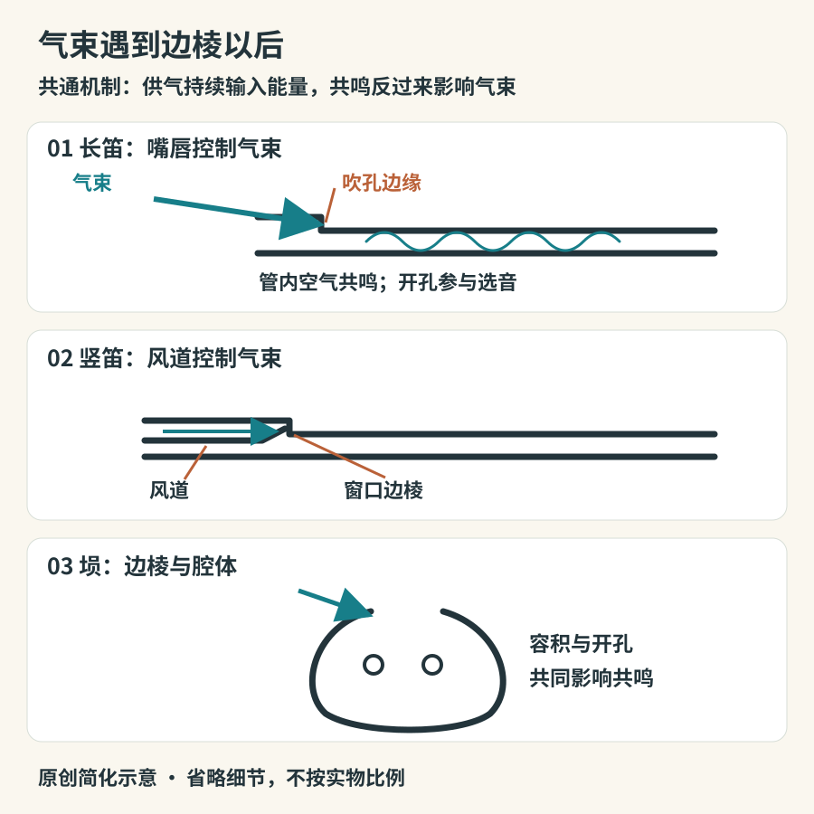

# 笛与箫：气流撞上边棱

长笛、竹笛、竖笛和尺八，看上去材料不同，拿法也不同，却共享一个重要办法：让气流经过边缘，与乐器内部的空气振动相互作用。这里没有需要敲击的弦，也没有嘴里夹住的簧片。听见的声音来自持续供气建立起来的振动，不是空气从入口走到出口时的一声摩擦。

## 边棱在哪里

把现代长笛横放，吹孔位于靠近头部的一侧。演奏者用嘴唇控制气束，使它对准吹孔对面的边缘；竖笛则以内部风道先把气束整理好，再导向窗口边缘。因此，竖笛容易吹响，不代表音乐表现只剩下按孔：舌头、气息和指法仍决定音头、音准及句法。[发声结构：Yamaha](https://www.yamaha.com/en/musical_instrument_guide/flute/mechanism/mechanism002.html)

气流与管内声场形成反馈：气束在边缘附近摆动，把呼气的一部分能量送入空气振动；管内的共鸣又反过来影响气束。改变指孔、气流速度和吹奏角度，可以改变系统容易维持的振动状态。“用力吹就升高一个音”不是普遍规则：同一指法可能换到另一音区，也可能只变响、变尖或失去稳定。[声学解释与音例：UNSW](https://www.phys.unsw.edu.au/jw/fluteacoustics.html)

*图09-1　原创简化原理图。箭头表示供气方向；管形、孔距和波形不按制造尺寸，埙的腔体不能套用长直管长度公式。*

## 从外形分清几个近亲

| 乐器           | 首先观察什么                     | 听辨时值得追踪什么                           |
|----------------|----------------------------------|----------------------------------------------|
| 现代长笛与短笛 | 横吹、侧吹孔、成组按键           | 气息与音头的衔接；短笛通常承担更高的音区     |
| 竖笛           | 嘴端有风道与窗口，直持           | 吐音是否清楚，长音是否平稳；别只联想学校课堂 |
| 中国竹笛       | 横吹，常见六个主要指孔与另设膜孔 | 笛膜带来的明亮、带沙感的音色成分             |
| 箫             | 端吹，吹口切口与长管身           | 气声与实音之间的变化，句尾的收束             |
| 尺八           | 端吹，吹口边缘与管身造型         | 改变吹角形成的音高、气声和音色变化           |
| 排箫           | 多根管并列，各有主要音高         | 旋律进行时换管的音头与衔接                   |
| 埙             | 有容积的腔体与若干孔             | 较集中的共鸣和气息边缘；不是缩短版竹笛       |

竹笛的膜孔与指孔不能混为一谈：指孔参与选音，薄膜则在声压作用下振动，显著改变音色。膜张得太紧、过松或被湿气影响，声音会变；不能由此断言“竹子本身发出金属声”。中国笛膜的声学作用已有专门测量研究，可把有膜、无膜的对照作为理解音色的入口。[SUTD博士研究：Dizi performance](https://repository.sutd.edu.sg/esploro/outputs/doctoral/Dizi-performance-acoustic-and-player-interactions/9910594809846)

尺八也不能用“日本的箫”一句带过。两者有可比较的端吹方式，却有各自的形制、指法、曲目和教学传统。格林内尔学院馆藏页提供尺八的实物、发声分类与演奏背景，适合把结构与实际声音对照着看。[Grinnell：shakuhachi](https://omeka-s.grinnell.edu/s/MusicalInstruments/item/2368)

## 金属长笛为什么仍在木管组

“木管”是乐队中的历史分组，不是逐件检验材料后的结论。现代音乐会长笛虽然常由金属制作，仍与其他木管共同编组；木制长笛也继续存在。十九世纪的波姆体系把音孔与机械按键的关系重新组织，使手指不必直接覆盖每个声学上合适的位置。按键的复杂，是为了让身体够得到合理的孔位，不是为了装饰。馆藏与制造指南能让人看见长笛经历了多种形制，不能把某一时期的金属长笛当作所有笛类的终点。[演变：Yamaha](https://www.yamaha.com/en/musical_instrument_guide/flute/structure/)

观察现代长笛时，先找头管、主管和尾管，接着找吹孔与按键。某些键通过联动同时控制别的孔，眼前按下一个键不一定只关闭一个孔。小短笛常能在全奏中被听见，既与音区有关，也与配器有关；“体积小所以音量小”在此很容易失效。[部件图：Yamaha](https://www.yamaha.com/en/musical_instrument_guide/flute/mechanism/)

## 怎样听出差异

先听独奏而非混响很大的背景音乐。长笛与竹笛的比较，可以依次注意三个位置：发音的最初一瞬、长音中部、收音之前。记录气声有多少、音色是否带明显膜振动的亮边、颤音是音高还是强弱在摆动。这些是观察，不是给音色贴“高级”“古朴”的排名。

接着比较同一种乐器的不同演奏者。若第二位竹笛演奏者的声音比第一位长笛演奏者柔和，就说明“某乐器永远明亮”这样的结论太粗。笛膜、音区、吹法、录音距离与作品都在改变结果。杜克大学的笛子馆藏条目将实物和历史图像并列；读者可借此观察横吹姿态与器物形制，但不应照搬其中转载的旧文献说明，把旧式孔数当作现代竹笛统一规格。[Duke：Dízi](https://sites.duke.edu/dumic/instruments/woodwinds/southern-and-eastern-asia/dizi/)

无须买乐器也能做一个小观察：对着空瓶口轻轻吹气，试着找到稳定声音，再向瓶里加一点水。气腔变小后，音高通常上升。这帮助理解腔体共鸣，不足以解释长笛全部指法；瓶口也不必接触嘴唇。最后给观察写一句有条件的结论：“在这个瓶子和吹法下，减少空气容积使主音升高。”科学的听辨从保留条件开始。瓶内水位影响的是腔体，不是演奏者的肺活量；两次比较时应尽量保持吹气角度相近。

## 一次有顺序的听辨记录

准备纸笔，选择有清楚乐器说明的一段独奏，先不看画面听二十秒。第一遍写它的音头是软还是硬，第二遍只追踪音与音之间有没有空隙，第三遍再打开影像，核对气息与手指动作。若结论与标注不符，不要立刻把答案改成“听错了”：记下原来依据了哪条线索。可能是高音竹笛较少显露你预想中的膜声，也可能是录音削弱了气声。

随后做一组控制变量的比较：尽量选择相近音区、相近速度、独奏且混响不大的录音。若拿低音箫的慢曲与短笛的快速高音比较，听到的首先是音区和演奏任务，不全是器物差别。最后只保留两条可以复听的判断，例如“这段的气声主要出现在开头”“这里每次换管都有小小重新起音”。这些记录比“更空灵”更方便下一次验证，也能逐步建立自己的听觉词汇。
