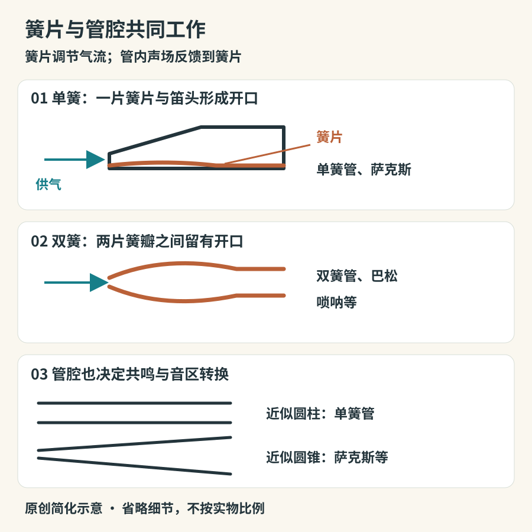

# 簧片的声音：单簧与双簧

萨克斯泛着金属光泽，单簧管常是深色的，唢呐带有醒目的喇叭口。它们并非因为外观相似而被放在一起，而是都让簧片调节进入管内的气流。理解簧片、管腔和手指的合作，比背“柔美”“嘹亮”等形容词更能帮助辨认。

## 簧片不是独自决定一切的小哨子

单簧管和萨克斯使用一片簧片，绑在笛头上，与笛头之间留下狭小缝隙。压差使簧片运动，改变缝隙与流量；管内的共鸣再反馈到簧片，使持续声音形成。演奏者的嘴唇、气压和舌头都参与其中。簧片较硬不等于声音必然更好，也不表示初学者应该尽早换最硬的型号。[单簧管声学：UNSW](https://www.phys.unsw.edu.au/jw/clarinetacoustics.html)

双簧管、巴松与唢呐则有相对的两片簧瓣。气流通过它们之间的开口，开口随振动改变。这里的“双”说的是簧瓣关系，不是有两支管子。不同双簧乐器还会使用不同的哨片、支撑件及吹口安排。[双簧发声：UNSW](https://www.phys.unsw.edu.au/jw/double-reed-acoustics.html)

*图10-1　原创简化示意。把开口放大以显示关系；并非哨片加工图。圆柱与圆锥只是管腔的主要近似，真实乐器包含局部修正。*

## 单簧管与萨克斯：同样单簧，为何差别明显

单簧管管腔总体接近圆柱，萨克斯则总体接近圆锥。管形改变共鸣的分布，也改变音区转换的方式：常规情况下，单簧管由低音区向上超吹，主要跨到十二度附近；萨克斯通常跨到八度附近。这说的是共鸣结构与演奏机制，不能误读成“单簧管没有偶数泛音”。实际乐音仍有复杂频谱，且随力度、音区和吹法变化。[萨克斯与单簧管对比：UNSW](https://phys.unsw.edu.au/jw/saxacoustics.html)

辨认时，单簧管通常是较直的细长管身，萨克斯则常有弯颈与弯起的喇叭口。不过高音萨克斯也常采用直管外形，不能把“弯曲”当作定义。高音、中音、次中音、上低音萨克斯承担不同音区，常用记谱调性也不同。同一段谱上的同一个音符，交给不同移调乐器未必响出同一实际音高。[萨克斯家族：Yamaha](https://www.yamaha.com/en/musical_instrument_guide/saxophone/structure/structure002.html)

萨克斯在十九世纪由阿道夫·萨克斯发展出来。它从设计之初就与管乐队的声音组织有关，后来成为爵士、流行、古典与实验音乐的重要媒介。它没有只属于爵士的天然音色；古典萨克斯演奏可以减少许多人熟悉的沙哑感，爵士演奏也并非一律粗粝。[历史：Yamaha](https://www.yamaha.com/en/musical_instrument_guide/saxophone/structure/)

## 双簧管、巴松、唢呐与管子

| 乐器           | 可以先看的结构                       | 容易被忽略的表现                         |
|----------------|--------------------------------------|------------------------------------------|
| 双簧管         | 细长管身、直接含入口中的小双簧哨     | 能以很轻的声音维持清楚线条，并非只会“尖” |
| 英国管         | 比双簧管更长，常见弯接管与梨形喇叭口 | 与双簧管相关但音区与色彩不同             |
| 巴松，又称大管 | 折回的长管腔，弯曲金属接管与双簧     | 低声部之外，也能唱出抒情的高音旋律       |
| 唢呐           | 双簧哨、指孔管身与扩口               | 地方形制、音区、哨片及演奏语汇差异很大   |
| 管子           | 通常较短管身与较大的双簧哨           | 管腔、哨片和地方流派共同形成独特色彩     |

巴松之所以看起来没有实际管路那么长，是因为气道折回。它常被安排幽默片段，却不应因此被称为“滑稽乐器”；换一段抒情独奏，它的任务就完全不同。同样，唢呐能在户外形成鲜明声音，不意味着它只能吹很响。

大都会博物馆藏十九世纪唢呐89.4.20，材质为木与铜合金，分类明确标为双簧气鸣乐器。这个实物案例也提醒读者：喇叭口并不把它变成嘴唇振动的铜管。关于传入路线与年代，不同材料有不同表述；本书保留其与西亚、中亚双簧管传统的关联，不用某一藏品说明推定所有地区的唯一传播时间。[The Met：Suona，89.4.20](https://www.metmuseum.org/art/collection/search/500597)

## 听音头，别只听长音

单簧或双簧的声音并不从完全相同的“零点”开始。舌头释放、气压建立及簧片响应，会使音头利落、柔和、带气或带轻微噪声。先找一段单声部演奏，比较短音和连音，再比较低音区与高音区。若只截取长音中间的一秒，可能错过很有辨识力的开头。

可用格什温《蓝色狂想曲》的开头作为观察题：先听颤动的起音，再听向上滑进高处的线条。它不是把单簧管做成了没有孔的滑管，也不是单靠“从低音吹到高音”；演奏者协调指孔覆盖、嘴型与声道。这一片段也是声学研究讨论的真实例子。[UNSW：单簧管声道与滑音研究入口](https://www.phys.unsw.edu.au/jw/clarinetacoustics.html)

再观看唢呐独奏影像，记录装饰音、滑音、模仿性音响与长句怎样分工。能听见持续长音，不等于已证明使用循环换气；需要观看演奏过程或查演奏说明。普通听众可在纸上画出句子的停顿，先学会分辨音乐呼吸，再考虑技术名称。

若亲自试吹，先由教师检查簧片安装、含口和姿势。哨片是需要维护的耗材，不能靠咬紧来强迫出音。第一次的目标应是稳定、舒适地发出几次声音，而非在噪声里吹满整首曲子。这样才能把结构知识转成身体能够重复的动作。若一口气能重复几个清楚的短音，就先记录这个成果；音量和音域可以随后逐渐扩展。

## 从一个声音回到一套系统

试着把听到的变化分成三栏：手指改变了什么、嘴部改变了什么、乐句要求改变了什么。一个突然跳高的音，可能来自换指法，也可能来自音区转换；一个变亮的长音，可能没有换音高，只是力度和频谱改变。观看近景时，可以先确认按键是否移动，再听音高，避免以“手很忙”推定“旋律很难”。

对不演奏的人，最有用的起步并不是背全音域，而是辨认两个音区之间的转变。同一件单簧管的低音可能厚而深，高音可能明亮而集中；只用一种音色标签描述整件乐器，会把这种内部变化抹掉。记录时把乐器名、音区、力度和录音条件放在一起。等积累了几次观察，再回到同一片段，通常能听见第一次只注意到旋律时忽略的换气、指键声与收音。
