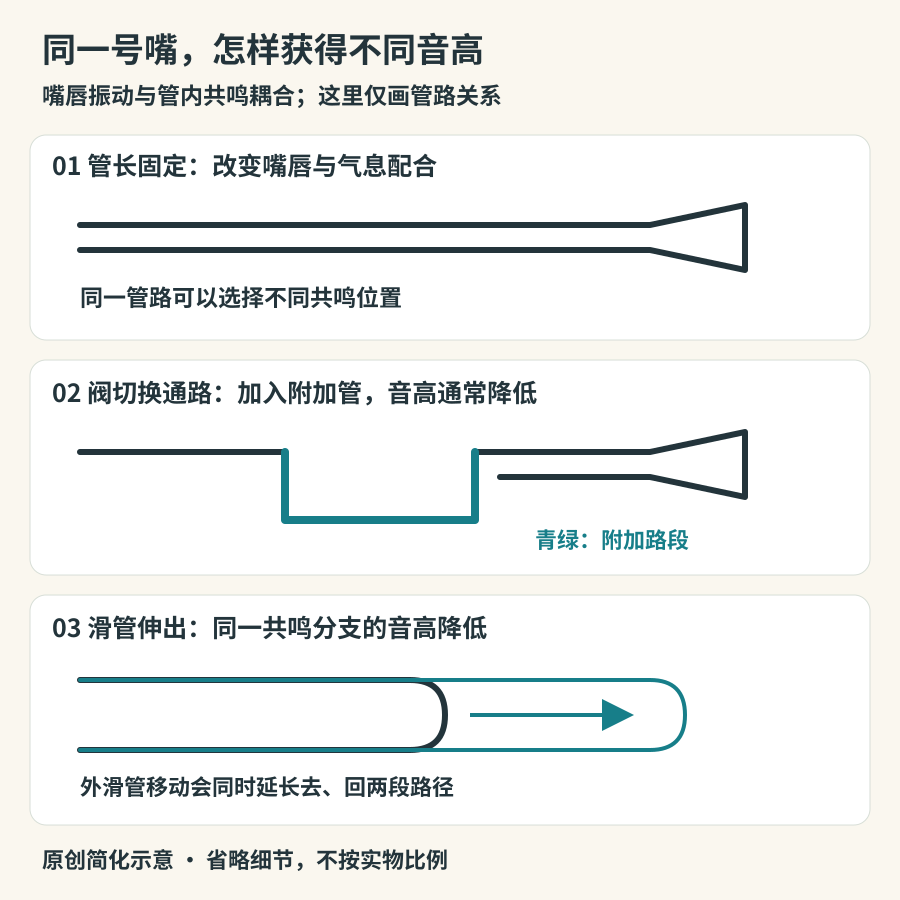

# 铜管：嘴唇与管道的协作

小号、圆号、长号、大号经常一起出现，但“铜管”首先涉及发声方式：演奏者的嘴唇在气流与管内声场作用下振动。金属管身既不是被敲响的钟，也不是单纯放大嘴唇声音的漏斗；它参与选择和塑造能够稳定发出的声音。用木材或其他材料制成的唇振气鸣乐器，也可以共享这一发声机制。

## 一套指法为什么能吹出几个音

小号演奏者不按任何活塞，也能吹出一串不同高度的音。固定管路有多个容易响应的共鸣，演奏者改变嘴唇状态、气息与口腔配合，在其中切换。这里应把“泛音列”当作理解入口，不把理想整数倍频率当成所有实际音的精确调律；吹口、喇叭口和真实管形会改变共鸣。[铜管声学：UNSW](https://www.phys.unsw.edu.au/jw/brassacoustics.html)

按下活塞，通常是把气流改道，让它经过一段额外管路，增加有效长度，使同一类共鸣整体降低。常见三活塞小号的三个阀分别承担约一个全音、一个半音、一个小三度的降低；组合使用仍要修正音准，不是按对按钮就自动精确。活塞与转阀采用不同机械办法切换通路，发声原理并没有因此变成两类。[阀与音高：Yamaha](https://www.yamaha.com/en/musical_instrument_guide/trumpet/mechanism/mechanism002.html)

*图11-1　原创管路示意。路径长度表示趋势，不代表具体型号尺寸；阀图只表示切换逻辑，不能用作阀体加工图。*

长号把同一问题做得更直观：滑管向外移动，管路变长，在同一共鸣分支上音高降低。由于滑管是连续移动的，音高也能连续变化；但跨越不同泛音位置时，并非任意两个音都能在常规指位内做成一条不断裂的长滑音。很多现代长号还带阀或附加管路，因此“长号没有阀”也只是初步印象。[滑管结构：Yamaha](https://www.yamaha.com/en/musical_instrument_guide/trombone/mechanism/mechanism002.html)

## 一组乐器，不是一种声音

| 乐器           | 外形线索                           | 乐队中常见作用与可听变化                         |
|----------------|------------------------------------|--------------------------------------------------|
| 小号           | 较紧凑的管路、杯形号嘴、常见三个阀 | 清楚的音头、旋律和节奏信号；弱奏也能细腻         |
| 短号与柔音号   | 与小号相近，管形和扩张方式有别     | 适合与小号比较同音区的音头与音色轮廓             |
| 圆号           | 盘绕管身、较大的喇叭口，常用转阀   | 能连接木管和铜管色彩；开阔强奏与柔和长线差异明显 |
| 长号           | 两条平行滑管，外滑管可伸缩         | 和声支撑、旋律、重音与连续滑音                   |
| 上低音号与大号 | 较大的盘绕管身和向上或向前的喇叭口 | 中低声部旋律、低音基础；绝非只能吹节拍根音       |

看管路时不要只量乐器外壳。圆号在视觉上比长号紧凑，却把长管盘绕在身体前方；大号也有不同调性、尺寸和管形。将管路展开，才更接近理解音区关系。大号家族的发展与十九世纪的阀技术密切相关；萨克斯号族与上低音号的关系也说明，乐器史常是多个制作者和型号并行的发展，不是一条单人接力线。[家族发展：Yamaha](https://www.yamaha.com/en/musical_instrument_guide/tuba/structure/structure002.html)

## 号角到阀管：技术改变能写什么音乐

没有现代阀的自然号，依靠不同泛音位置、替换弯管及演奏技术工作。高音区的相邻泛音更接近，某些旋律因此可以在特定音区组织出来。阀的推广让演奏者更方便地在多套管长间切换，扩展了半音进行与调性变化的实际可能性。旧乐器并不因此失效：历史演奏和地方传统仍保留它们特有的声音与句法。

比较现代小号的活塞与转阀时，应看切换机构，而非凭国籍断言哪种“更高级”。制造指南列出了两种系统的结构及其使用背景；具体声音仍取决于管形、号嘴、演奏和录音，不能把单个机械差异解释成全部音色差异。[活塞与转阀：Yamaha](https://www.yamaha.com/en/musical_instrument_guide/trumpet/mechanism/mechanism004.html)

## 弱音器不是音量旋钮

往喇叭口放入适当的弱音器，会改变声音辐射和声学负载，通常兼有音量与音色的变化。不同弱音器可以让小号或长号显得集中、带鼻音或产生特殊音响。因而乐谱写了弱音器，往往是在要求一种色彩，并非只说“请小声一点”。圆号的右手位置同样会影响声音，堵奏又是更特殊的技术；不要把普通放手与完全堵住视为一回事。[右手与堵奏：Yamaha](https://www.yamaha.com/en/musical_instrument_guide/horn/play/play002.html)

做听辨时，先选同一支乐器的无弱音器和有弱音器版本，再听不同乐器。这样能避免把“某种小号弱音器的声音”误认成另一件乐器。观察图像时看喇叭口，记录是否有插入件；仅凭较小音量不能推定用了弱音器。

一个有用的练习是观看铜管五重奏：先找两件小号，再找圆号、长号和大号；只听十几秒，记录旋律落在谁身上、最低音由谁承担、谁与谁同时起音。重复时只追踪大号，常能发现低声部也在移动和回答，并非一块不变的地板。

若想试吹，先由教师或体验课程提供适合的号嘴与乐器。为了追高音而挤压嘴唇、持续憋气，不是练习效率的证明。低而稳定的短音、自然换气、间隔休息，更能让人感到嘴唇与管路确实在合作。理解泛音的最好起点，是成功重复一个舒服的声音。

## 把旋律与低音分别听一遍

同一段铜管合奏可以拆成三次阅读。第一遍追最容易哼出的旋律，第二遍跟随最低的声部，第三遍只听每次大家同时开始和停止的边缘。铜管的合奏感不只靠响度：几个声部如何形成共同的音头、延音中如何调整和声、句尾如何一起收束，都会改变整体的清晰程度。

再做一次距离比较：听录音中的铜管，很容易把近距离拾音的锐利当作乐器永远的本性。若有音乐厅现场经验，可留意声音在远处与其他声部融合的效果；没有现场条件，也可选择同一乐团不同机位的官方影像作观察，先确认音轨是否相同。它不能严格替代声学测量，却能提醒我们区分演奏、空间与录音。每次只改变一个观察重点，比在一遍音乐里同时猜乐器、数音符和评判音色更容易有所收获。
