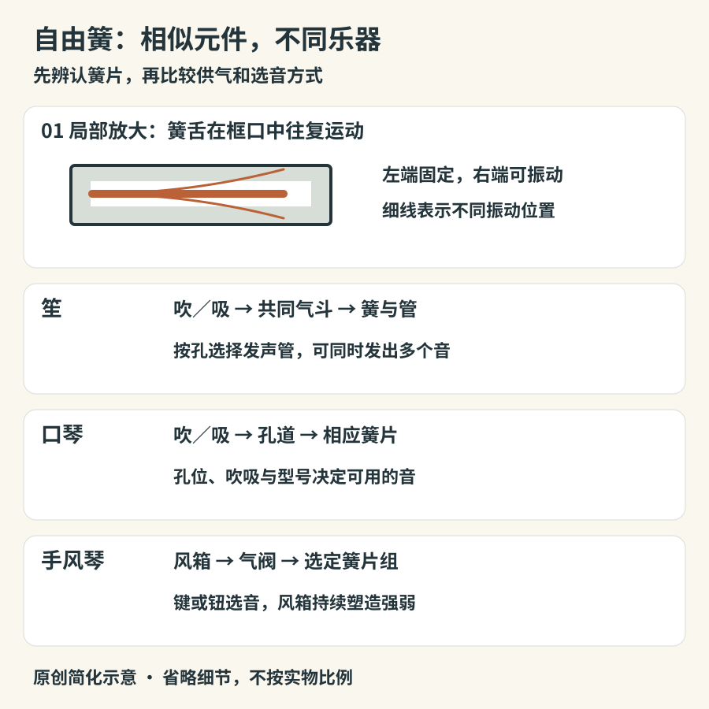

# 自由簧：笙、口琴与手风琴

一片薄金属舌片安置在框口里，气流使它来回运动，并能穿过框口平面而不需要不断拍打硬边。这种结构叫自由簧。它既可藏在一束竹管的底部，也可排在口琴里，或装进手风琴的大箱体。相似的发声元件不代表相同的按法、调律与音乐传统。

## 先看供气，再看选音

自由簧的振动与簧片的尺寸、质量分布和弹性有关，但音高不一定只由一片孤立簧片决定。簧片和周围的气腔、管子相互作用：笙尤其需要理解簧与管的合作；葫芦丝和巴乌也不能完全照搬口琴的解释。反过来，把所有自由簧乐器都说成“开孔缩短气柱”也不准确。

*图12-1　原创简化示意。簧片位置为原理放大图；下方省略簧片组、气阀与连接细节，不是三件实物的等比例剖面。*

笙通常把多根管插入共同的气斗，演奏者通过吹或吸供气，并用手指控制相应孔。传统笙与现代扩展型号的管数、音域和操作安排不同，也不是每根看得见的管在每件历史乐器上都一定发声。它能同时发出多个音，因而既能走旋律，也能构成和音；现代键笙又发展了不同的演奏与编制可能。[结构与演奏：Grinnell，sheng](https://omeka-s.grinnell.edu/s/MusicalInstruments/item/1248)

葫芦丝常以葫芦形气室连接一根有指孔的主管及旁管。主管负责旋律，某些旁管可形成持续音；也有旁管不发声或构造经过改动的型号，不能从“有三根管”直接推出“三根都能演奏旋律”。其名称与形制涉及中国西南多个族群的传统，不宜简化成一种没有内部差异的地方纪念品。[Grinnell：hulusi](https://omeka-s.grinnell.edu/s/MusicalInstruments/item/1531)

巴乌常横持，外观容易与竹笛混淆，实际吹奏处藏有簧片。它没有依靠膜孔工作的笛膜，最直接的识别方法是观察吹口附近的构造。演奏中滑音、倚音与音色变化和指法、气息密切相连；“柔和”只能描述某些演奏结果，不能替代结构说明。[Grinnell：bawu](https://omeka-s.grinnell.edu/s/MusicalInstruments/item/1532)

## 口琴：很小的外壳里有怎样的分工

口琴内部的簧片分置于不同通气孔道中。常见布鲁斯口琴利用吹、吸在同一孔位发出不同音；复音口琴常以略有音高差的一对簧片形成拍频听感；半音阶口琴则常用推键切换气道，取得另一组音。它们不是“从便宜到专业”的三级，而是结构与用途不同。[口琴内部与供气：Grinnell](https://omeka-s.grinnell.edu/s/MusicalInstruments/item/2385)

布鲁斯口琴的压音尤其容易被说得过于简单。它不只是把风吹得更大，也不是把金属簧片用舌头压低：演奏者调整口腔与声道，改变与簧片系统的耦合，常涉及同孔吹吸簧片的共同响应。不同孔的可压音范围并不相同。第一次学习先取得干净单音，再在教学指导下探索压音，会比试图用猛吸把音“拽下来”更有收获。[实验研究：Bahnson、Antaki与Beery，1998](https://www.cs.bu.edu/faculty/snyder/TablatureWeb/Bahnson%20JASA%201998.pdf)

听口琴时，可以追踪三类变化：吹吸转换处的衔接、一个音内部的滑动、多个音共同发出时的粗细感。若一段演奏忽然出现连续上行的半音，先不要凭耳朵判断一定是半音阶口琴：技巧和调性安排可能使不同型号产生相近的局部效果。

## 手风琴：风箱也在塑造句子

手风琴用双臂推动风箱形成压差，键或按钮控制气阀，让选中的簧片发声。右手常负责旋律和和声，左手可能使用预设低音与和弦系统，也可能使用自由低音系统。键盘外观并不意味着内部有琴弦：这里的键是控制界面，声音来自自由簧。[键盘手风琴：Grinnell](https://omeka-s.grinnell.edu/s/MusicalInstruments/item/2384)

钮式手风琴的按钮布局有多个系统；有些乐器推拉同一按钮发不同音，有些发相同音。不要只从圆形按钮推定它属于哪一种。风箱改变声句的强弱和方向，注册键切换不同簧片组，带来音区与音色的变化。因此，长音能逐渐增强，是供气持续参与声音的结果，不是钢琴式“敲下以后自己消退”。[钮式手风琴实例：Grinnell](https://omeka-s.grinnell.edu/s/MusicalInstruments/item/2387)

班多钮是另一条重要支线，外形像两端有按钮的方形风箱乐器，不能把它当作普通手风琴的缩小版。它在欧洲发展，经迁移和音乐交流进入拉普拉塔河地区，成为探戈的重要声音；这一历史体现的是乐器被新社群重新使用，而非某种声音天生只属于一个国家。[Smithsonian：Bandoneon](https://music.si.edu/object-day/bandoneon)

## 听见一件乐器，也听见它怎样呼吸

比较笙与手风琴的持续和音，先注意和音是否从同一时刻开始、是否保持稳定、声部是否能分别移动。再看演奏影像：笙的呼吸由身体供给，手风琴依赖风箱；同样的持续音，背后动作不同。比较口琴与班多钮，则可以听短句之间的空隙、音头与滑动，感受不同气路和操作方式如何进入音乐。

一个无器材练习是为十秒钟演奏画出强弱曲线。不要画所有音符，只标出渐强、渐弱和停顿，再观察演奏者的呼吸或风箱动作是否相应。第二次只追踪持续低音：旋律换音时，它是否留在原处？这样的观察能将“悠扬”“有感染力”等感受，转成可检验的音乐细节，也能避免把所有自由簧听成同一种音色。

## 用结构回答常见误认

看到一件带键盘的乐器，可以按顺序问三个问题：按键之后什么被启动，能量从哪里来，一个音是否能够在持续供能中渐强？手风琴的答案是气阀、风箱与自由簧，因此与同有黑白键的钢琴走了不同的发声路径。看见多根竹管时也先问：每管是否对应独立的簧片或吹口，选音依靠换管、按孔还是按键？这样就能把笙与排箫分开。

比较乐器之间的关系时，最好同时保留“元件相似”和“传统各异”两句话。相似的簧片结构可以服务舞蹈、叙事、合奏和独奏；不同地区的调律与装饰语汇，不能从一张剖面图里读出来。结构图解决的是声音如何可能发生，真实演奏说明它怎样成为音乐。二者合起来，才不会把世界乐器史缩成一棵只有祖先和后代的简单家谱。
