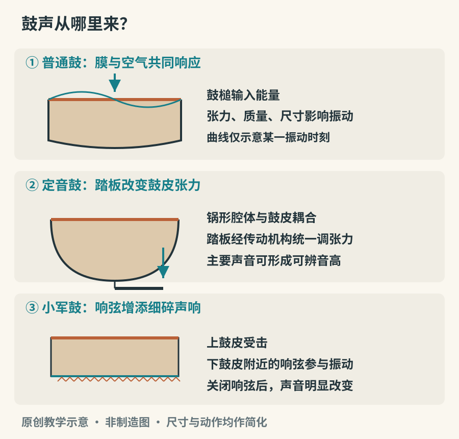

# 鼓：膜、空气与节奏

鼓声并不只有“咚”和“嗒”。同一张鼓皮，击打靠近中心与靠近边缘，手指留在皮面与立即离开，便可能产生不同的音高感、明亮度与尾音。听鼓的第一步，是把一次打击拆开：最前面的撞击声、随后形成的共鸣，以及最后如何停止。节奏由这些声音的先后组成，音色则让每一击具有不同的分量。

## 膜、空气和鼓腔一起工作

鼓皮受到敲击后，不是整张像活塞一样上下移动，而会同时出现多种振动形态。理想均匀圆膜的各振动频率通常不按整数倍排列，因此许多鼓不像吉他弦那样提供明确、稳定的旋律音高。但这不等于“鼓没有音高”。鼓皮尺寸、张力、质量分布、鼓腔与空气的耦合，以及敲击位置，都会改变我们听到的结果。

把鼓绷紧，往往会提高它主要振动成分的频率；换更大、更多质量的鼓皮，结果又会改变。实际调音还要考虑鼓皮各处张力是否均匀。拧紧一个螺丝不仅改变附近的一小块皮，也会影响整张膜，因此不能把“每颗螺丝拧相同圈数”当成调音完成。

*图 13-1　原创简化剖面示意。箭头表示作用关系，未画出所有振动模态；定音鼓与小军鼓不能按这张图的比例制造。*

## 定音鼓为什么能够调出音符

定音鼓的鼓皮安装在锅形腔体上。演奏者在上台前根据曲目所需音高调音，踏板式结构能够统一改变鼓皮张力，在演奏中切换音高。这里的“定音”是可辨认的音乐音高，并非整场固定不变。鼓皮与腔内空气的相互作用，是它与普通圆膜模型不同的重要原因。踏板改变张力的具体传动方式则因设计而异。[资料：Yamaha《Construction of the timpani》](https://www.yamaha.com/en/musical_instrument_guide/timpani/mechanism/mechanism002.html)

听定音鼓时，可以先寻找它与低音乐器的关系：一击是否与低音声部落在同一个音上？鼓声延续时能否哼出一个大致稳定的音？滚奏不是把鼓变成永不衰减的声源，而是用连续击打补充能量。软硬不同的槌头，会改变起音的清晰程度；击打位置也影响共鸣。[资料：Yamaha《Where does the player strike the head?》](https://www.yamaha.com/en/musical_instrument_guide/timpani/play/play003.html)

## 小军鼓、大鼓和通鼓各负责什么

小军鼓通常有两张鼓皮，底皮附近绷着响弦。上皮受击后，空气和结构传递的振动使底皮与响弦产生相互作用，于是鼓声多出细碎的“沙”声。关闭响弦，小军鼓仍然会响，但性格改变明显。所谓“小军鼓音色”，包含皮、腔与响弦的共同结果，不只是鼓皮的一种声音。[资料：Grinnell College 馆藏“小军鼓”](https://omeka-s.grinnell.edu/s/MusicalInstruments/item/950)

大鼓常用较低、较宽厚的声音标记重音，管弦乐大鼓和架子鼓的底鼓并非同一种演奏设置。前者可以用双槌、滚奏及丰富的止音方式，后者常由脚踏机构击打，并与双手和另一只脚协作。通鼓没有小军鼓那样的响弦，通常更容易听见鼓腔与鼓皮形成的音高走向；不同尺寸的通鼓连接起来，能形成由高到低的填充句。

架子鼓是组合系统，而不是一种单一声源：鼓属于膜鸣乐器，踩镲与其他镲片属于体鸣乐器。把它们放在一个人的控制范围内，带来了四肢分工和声音之间的配合。它的发展与现代娱乐、舞蹈及爵士乐实践相连，不能用一位发明者、一个年份概括。小军鼓更早的军队用途则能从历史实物中看到：大都会艺术博物馆保存的美国小军鼓，说明了它与军队行进和日常信号的联系。[资料：The Met 馆藏《Snare Drum》](https://www.metmuseum.org/art/collection/search/501206)

## 塔布拉与框鼓：手掌也是调音工具

塔布拉通常是一对大小与构造不同的鼓。鼓皮上增加的调音材料改变质量分布，使若干振动成分更接近谐波关系。演奏者用手指、掌根及接触位置塑造不同击法；较低的鼓还能通过压力变化产生明显的音高弯动。它既能伴奏，也有独奏传统，绝非给旋律“配个节拍”的背景工具。关于质量分布与谐波形成的关系，可参看声学研究，而不宜仅凭黑色圆斑的外观推断。[资料：Malu、Siddharthan《Acoustics of the Indian Drum》](https://arxiv.org/abs/math-ph/0001030)

框鼓的共同点是较浅的框体，并非所有框鼓都有铃片，也并非所有都以同一姿势持握。手指控制的轻击、掌部的低音、边缘的短音，可以在一张膜上建立层次。一旦认识到“另一只手也在改变声音”，便容易理解为什么只模仿敲击顺序，常常得不到示范中的音色。

## 读懂一次鼓的填充句

架子鼓从稳定节奏进入一小段填充时，先听它有没有保留可以感到的拍点。填充常用通鼓的高低、不同音色和击打密度制造方向，最后在新乐句起点回到稳定节奏。复杂不只是多打几下；一个恰好留空的重拍，也能让下一次进入更有分量。

观察演奏视频，还可以追踪止音。手掌碰住鼓皮、鼓槌留在或离开皮面、脚控制底鼓踏板，都会影响尾音；但具体做法随风格与音色目标改变。听见短音，不必立即判断是鼓本身没有共鸣，也可能是演奏者主动结束了它。

## 做一次不需要买鼓的听觉实验

准备一个结实的空纸盒，轻敲盒盖中央与边缘，保持力度接近。再用另一只手轻触盒盖，重复敲击。这个实验使用的是固体盖板，不是鼓膜，不能据此测量鼓的规律；它的用途是听清“激发位置”和“止音接触”能改变结果。

若能接触真实小军鼓，请演奏者依次示范响弦开启、关闭，以及相同节奏下的开放声与制音声。听的时候先忽略快慢，只记录三件事：起音是否尖锐、尾音是否带沙声、声音多久结束。不同鼓的区别会比一串“雄浑、激昂”的形容词更具体。

最后再听一段塔布拉独奏。先不要试图数出全部节奏，而是选定一个重复出现的低音，追踪它如何与清脆的高音交替。随着熟悉程度增加，再尝试识别循环的回归点。鼓乐的组织既发生在每一击内部，也发生在长时间的循环之中。[延伸研究：Gowriprasad 等《Structural Segmentation and Labeling of Tabla Solo Performances》](https://arxiv.org/abs/2211.08790)
