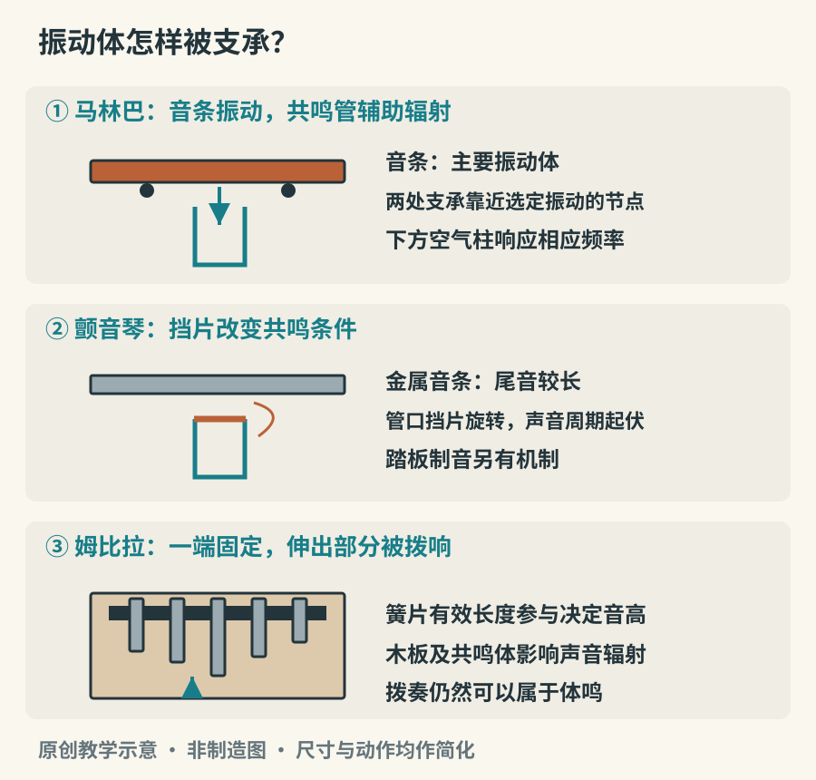

# 木、金属与石：体鸣乐器

敲一块木板和敲一口钟，都能让物体自身振动。这里主要发声的不是绷紧的弦、膜或管内气柱，而是木条、金属片、钟体等固体本身。这一大类叫体鸣乐器。它包括敲击，也包括摇动、刮奏、拨奏等方式，因此“体鸣”不能直接替换为“打击”。姆比拉的金属簧片由手指拨动，同样属于体鸣。

## 先看振动物体怎样被固定

木琴与马林巴常把长短不同的音条排成类似键盘的布局。演奏者用槌击打音条，音条自身弯曲振动；下面的共鸣管让相应频率附近的声音更充分地辐射出来。共鸣管不是另一根需要敲击的“音条”，也不能只根据管长来判断整件乐器的音高。音条与共鸣管各有作用。[资料：Yamaha《What kind of instrument is the marimba?》](https://www.yamaha.com/en/musical_instrument_guide/marimba/mechanism/)、[《Inside and outside the resonator pipes》](https://www.yamaha.com/en/musical_instrument_guide/marimba/mechanism/mechanism002.html)

*图 14-1　原创结构示意。马林巴采用两处附近的支承，姆比拉簧片的一端则被夹持；图中省略绳结、桥与实际尺寸。*

理想均匀木条的弯曲振动也不天然构成完整谐波列。制作者会对音条底面进行有控制的削薄，使某些振动成分落在合适的关系上。木条越长、通常越低的经验很有用，但厚度和削薄轮廓也参与决定结果；不能拿“锯短一点”代替制作与调音。[资料：Yamaha《There is craft to the design of the tone plates, too》](https://www.yamaha.com/en/musical_instrument_guide/marimba/mechanism/mechanism003.html)

## 五种常见的有固定音高打击乐

| 乐器   | 主要振动体             | 听辨时先关注什么               |
|--------|------------------------|--------------------------------|
| 木琴   | 木质或相应合成材料音条 | 起音清楚，短音轮廓突出         |
| 马林巴 | 木质或相应合成材料音条 | 低音区的丰满感与较柔和的音头   |
| 颤音琴 | 金属音条               | 较长的延音、踏板制音与周期起伏 |
| 钟琴   | 金属音条               | 高音区明亮、集中的铃声感       |
| 管钟   | 金属管                 | 复杂的钟声色彩与较长余响       |

这是帮助开始听辨的倾向，不是给每个音色盖章。槌头硬度、演奏音区、录音方式和制音都能显著改变听感。马林巴低音也可以很清晰，钟琴轻奏时也能非常细腻。若录音中只有很短的高音片段，木琴、马林巴和其他敲击声的边界可能并不容易判断。[资料：Yamaha《Relatives of the marimba》](https://www.yamaha.com/en/musical_instrument_guide/marimba/structure/structure002.html)

颤音琴的共鸣管口附近有旋转挡片，周期改变共鸣条件，让音量与音色产生起伏；常见名称虽叫“颤音”，也不应把它理解成音条音高必然上下摆动。它还有制音踏板，演奏者需要像处理标点一样安排延音与停止。[资料：Yamaha《The vibraphone and its spinning fans》](https://www.yamaha.com/en/musical_instrument_guide/marimba/trivia/trivia004.html)

## 锣、钹和钟，不只是“大声”

锣与钹的曲面、厚度分布、边缘形状和加工状态会影响振动。锣可以有明确音高，也可以以复杂音响为主；钹同样存在多种用途。合击钹、悬吊钹与踩镲有不同的控制方式，开合、夹持、抓止余音，都是演奏的一部分。

钟体也不是“越大就一定越低”这么简单。形状和厚度共同决定振动关系。中国古代编钟尤其提醒我们，不同钟型不能套用同一种规则。曾侯乙编钟以成套乐器、铭文及音乐制度信息著称，部分钟能够通过不同击奏位置得到两个主要音高。这是特定结构与振动模态的结果，不等于任意一口圆钟都能稳定奏出两个预定音。[资料：国家档案局公开《The Suizhou Bianzhong of Marquis Yi of Zeng》申报材料](https://www.saac.gov.cn/mowcn/cn/c100512/202506/382e5c53ec654d16aeb7eedeaaf7389f/files/7c1d5b69c72c43c58f05a116a2f2d72d.pdf)

看实物时，可以先分清“敲击位置标记”和“装饰纹样”。听演奏时，则比较单击后的余音与连续音符之间的关系。乐器的历史价值包含制造、测音、演奏和礼仪组织，不能只被浓缩成一条惊人的数字。

## 被拨响的金属：姆比拉与相邻乐器

姆比拉不是缩小版钢琴。常见结构把金属簧片装在木板上，簧片的一端受到固定，伸出的部分被手指拨动。有效长度、厚度和材料影响音高；演奏者双手交错产生循环乐句。部分乐器置于葫芦或木质共鸣体中，还会加入细碎的嗡鸣色彩。马拉维和津巴布韦的 Mbira/Sansi 传统也包含制作知识、社会实践与传承，并非只有一个可复制的音色。[资料：UNESCO《Art of crafting and playing Mbira/Sansi》](https://ich.unesco.org/en/RL/art-of-crafting-and-playing-mbira-sansi-the-finger-plucking-traditional-musical-instrument-in-malawi-and-zimbabwe-01541)

“卡林巴”“拇指琴”等名称在市售乐器中很常见，但不能用某种商品化布局代表全部姆比拉传统。看见错落排列的簧片时，先研究手指怎样在两侧连接旋律，再判断它为什么如此排列。对称好看和演奏顺手，未必指向同一种设计。[旁读：Australian Museum《Mbira—Thumb Piano of Africa》](https://australian.museum/learn/cultures/international-collection/african/mbira-thumb-piano-of-africa/)

## 钢舌鼓、手碟与音高布局

钢舌鼓在金属壳体上切出可振动的舌片；手碟通常通过锤制的音区形成不同振动特征。钢舌鼓可依设计用手或配套软槌演奏；手碟通常用手指轻击，不应自行套用钢舌鼓的槌击方式。两者结构不同，不能只因外观像圆盘就互换名称。[资料：Meinl Sonic Energy《How to use》](https://gerber.meinlsonicenergy.com/meinlsonicenergy/en/topics/How-to-use)它们常把选定音阶安排在有限音区中，使许多组合听起来协调；这是一种设计选择，并不是演奏者自动掌握了所有调性。

看到一件只有少数音的乐器，可以先寻找最低音，再画出其他音区的位置；听一段演奏，标记它是否反复围绕某个音回归。布局既影响手的路线，也影响常见乐句。面对没有半音的布局，某些旋律需要改写，另一些则自然适合。限定音集可以降低开始演奏的门槛，也同时规定了声音选择的范围。

## 一件器物，几种结束方式

找一个坚固、没有裂损的金属勺，轻轻让它接触另一件不易损坏的器物，再用手抓住勺柄与勺身的不同位置，比较余音。用轻柔动作即可，不需追求大音量。这个观察的重点是：固定与接触会吸收振动，声音何时结束往往取决于演奏者。

再看一段颤音琴演奏，观察脚与手是否同时动作。挑一个和弦，听它延续时下一句如何进入。最后听姆比拉的循环，不急着按西方和弦进行解释；先追踪一个短音型，听它怎样与另一只手交错。相似的材料能够进入很不相同的音乐组织，体鸣乐器的世界也因此远比“敲什么响什么”丰富。
