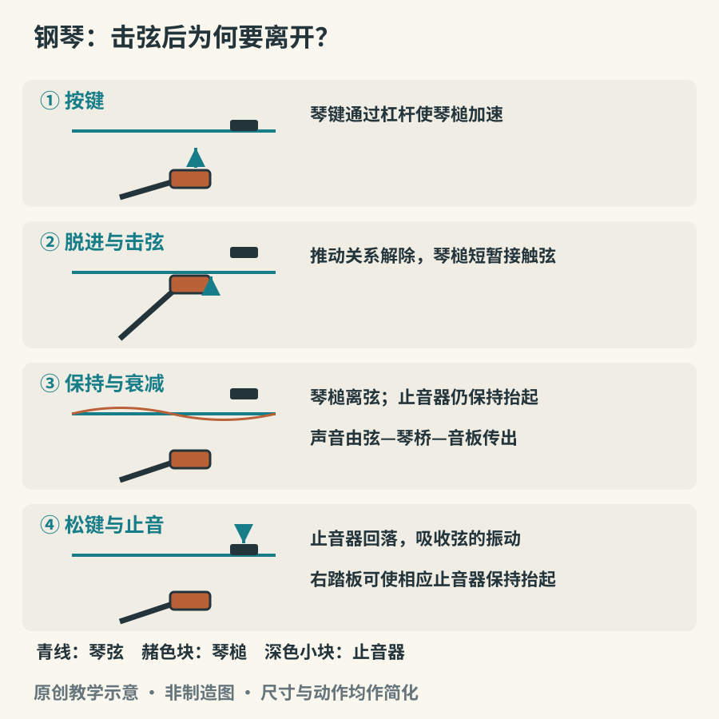

# 键盘背后：钢琴与击拨弦机构

钢琴看上去最显眼的是键盘，发声的关键却藏在里面。手指把琴键压下，一系列杠杆让琴槌加速，琴槌击弦后离开，弦的振动经琴桥传到音板，最后由音板与琴体向空气辐射。键盘把复杂动作变成容易定位的入口，却没有替演奏者决定触键、句法与声音层次。

## 为什么琴槌必须离开琴弦

如果把一块毡一直顶在正在振动的弦上，声音会被压住。钢琴击弦机构的重要任务，正是让琴槌受控地击弦，又能及时脱离。这个让推动关系在击弦前解除的环节，称为脱进或擒纵。它使琴槌完成短暂接触，弦随后能够继续振动。

早期钢琴制作人克里斯托福里在十八世纪初的乐器中实现了这一类关键机制。大都会艺术博物馆保存的 1720 年钢琴，能帮助我们理解早期设计，而不是证明现代三角钢琴从此再无变化。琴弦、框架、音域和击弦机构此后仍经历了长期发展。[资料：The Met《The Piano: The Pianofortes of Bartolomeo Cristofori》](https://www.metmuseum.org/de/essays/the-piano-the-pianofortes-of-bartolomeo-cristofori-1655-1731)

*图 15-1　原创功能示意。为说明动作次序，省略中间杠杆；有止音器的音区，其止音器在击弦前已离弦，保持按键时继续抬起。不同三角琴与立式琴的机构方向、形状和复奏设计不同。*

琴键压得更快，通常会使琴槌以更高速度接近琴弦，带来更大的声音及不同的频谱分布。因此“轻、重”不能只按手指施加的静态重量理解；同样按到底，声音仍可能不同。击弦后继续使劲压住琴键，也不会让已经离开的琴槌重新给同一个音补充能量。

现代三角钢琴的复奏机构使琴键不必完全回到最高处，就能准备再次击弦。它影响快速重复音的反应，却不等于演奏者可以忽略放松与回键。立式琴采用适应垂直琴弦布局的设计，比较时应观察实际触感，而不是仅凭外形大小排定一切性能。[资料：Yamaha《What is a Piano’s “Action”?》](https://www.yamaha.com/en/musical_instrument_guide/piano/mechanism/mechanism003.html)

## 一根弦怎样让整个房间听见

单独一根金属弦接触空气的面积很小，向外传声的能力有限。琴桥把振动传给音板，较大的振动表面参与辐射，于是我们听到钢琴的音量与共鸣。低音弦常通过增加单位长度质量获得所需低音，不必无限加长；中高音区同一音常由多根弦共同发声。具体配置随琴型、音区而异，不能说每键固定对应三根弦。[资料：Yamaha《The Sound-Producing Mechanism》](https://www.yamaha.com/en/musical_instrument_guide/piano/mechanism/mechanism002.html)

这一点也解释了为什么钢琴不是“声音完全相同的按钮阵列”。低、中、高音区的起音和衰减不同，同一和弦的排列一改变，密度和清晰度也随之变化。在低音区把许多音挤得很近，可能变得浑浊；把旋律放到较清晰的音区，则更容易从伴奏中浮现。这是练耳与编配共同关心的事。

## 三种踏板，先学会听延音

右踏板通常使止音器离弦，让已弹音和其他可共振琴弦延续振动。最高音区往往没有同样的止音器配置，因此不能用“一踩所有弦都从静止变为振动”描述它。踏板松开时，受控制的弦回到止音状态，尾音发生明显变化。

左踏板的作用因琴型而异：三角琴通常让击弦机构横移，改变槌弦接触；立式琴常通过缩短琴槌行程改变反应。中踏板更不能一概而论，可能是选择性延音，也可能承担练习弱音等功能。第一次接触一台琴，最好先问清功能再试。

做一个短实验：在允许演奏的琴上弹一个中音，不踩踏板，松手听结束；再踩右踏板重复，松手后等两秒再松踏板。记住差别后，弹两个简单和弦，故意让旧和弦余音盖住新和弦，再练习在转换处清理。目标是听清和声，而不是让脚保持连续动作。

## 名称相近，发声方法可以完全不同

| 类别                     | 琴键最终怎样作用于声源   | 音量与持续的典型特点                           |
|--------------------------|--------------------------|------------------------------------------------|
| 羽管键琴                 | 拨片拨弦                 | 起音明确；触键力度对响度的直接控制较有限       |
| 击弦古钢琴（clavichord） | 小金属切线击弦并保持接触 | 音量较小，可通过触键压力作细微变化             |
| 早期钢琴（fortepiano）   | 琴槌击弦后脱离           | 能用触键控制强弱，历史琴型差异很大             |
| 现代原声钢琴             | 现代击弦机构、琴弦与音板 | 动态范围与延音随琴型、音区变化                 |
| 数字钢琴                 | 传感器控制数字声源       | 可用采样、建模或混合技术，并经扬声器或耳机输出 |

中文“古钢琴”有时混指几类乐器，阅读节目单最好同时核对外文名称。Clavichord 的金属切线不仅激发琴弦，还参与限定振动长度，因此它与琴槌击弦后立刻离开的钢琴具有不同的触键关系。[资料：The Met 馆藏《Clavichord》](https://www.metmuseum.org/art/collection/search/504534)

数字钢琴可以使用带配重或琴槌模拟的键盘，但这些机构通常服务于触感和传感，并非必须去敲击真实琴弦。它与原声钢琴的比较要分开问：手感怎样、声源怎样、扬声器怎样、耳机体验怎样。把其中一个答案当成整台琴的优劣结论，会失去真正有用的信息。[资料：Yamaha《Acoustic or Digital?》](https://www.yamaha.com/en/musical_instrument_guide/piano/selection/selection002.html)

## 旋律为什么能从十个手指中浮现

钢琴允许多个音几乎同时出现，演奏者却很少希望每个音都同样突出。可以在很简单的双音练习中尝试：把高音当旋律，低音轻弹；再交换主次。若两个音都清楚而其中一个更容易跟随，就已经开始处理层次。这里的难点不在按对琴键，而在于用不同触键组织注意力。录音回听往往比边弹边判断更容易。

## 用同一段音乐认识不同时代

选一段熟悉的巴赫键盘作品，分别听羽管键琴和现代钢琴演奏。不要先判断谁更“高级”，而应留意：声音的开头怎样排列？一条旋律靠什么持续？声部清晰度来自触键、速度、音区还是录音？作品可以相同，乐器的条件却会引导演奏者作不同选择。

再听早期钢琴与现代钢琴的莫扎特作品。不要把历史录音的差异全归给年代；演奏者、房间、话筒与修复状态也参与结果。学会承认这些变量，才更容易听到乐器真正提供的可能性。
