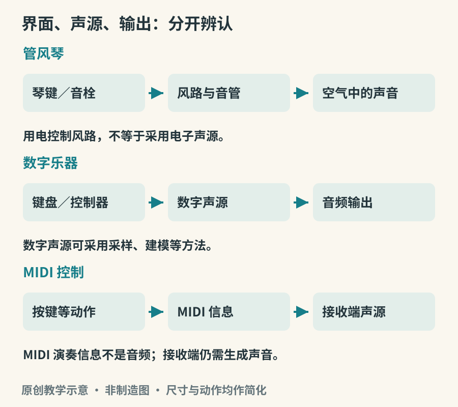

# 管风琴到合成器

相同的黑白键，可以控制琴弦，也可以打开风路、改变电路或向软件发送消息。因此“键盘乐器”描述的是一种操作界面，并不直接回答声源问题。认识这一点，管风琴、电子琴、合成器、数字钢琴和控制键盘就不再是一串容易混淆的名字。

## 管风琴先是一件吹奏系统

管风琴通过供风装置把空气送入音管。演奏者按键时，相应风路开启，让被选择的音管发声。唇管通过气流与管口边缘相互作用形成振动；簧管则含有振动簧片。它们的声源不同，却由同一套键盘和音栓系统组织起来。[资料：Yamaha《The organ as a wind instrument》](https://www.yamaha.com/en/musical_instrument_guide/pipeorgan/mechanism/)

一排或一组相应音色的管列，可以通过音栓选用。不同管列组合，使一个按键触发多个声音成分；部分管列按八度或其他音程关系叠加，听觉上能够融合成新的音色。音栓因此不只是音量开关。认识一台管风琴，要看它有哪些管列、分别放在哪里，以及演奏空间怎样参与共鸣。[资料：Yamaha《Producing a variety of timbres》](https://www.yamaha.com/en/musical_instrument_guide/pipeorgan/play/)

*图 16-1　原创功能链路示意。电子声源可以是模拟、数字或混合实现；图中把多种设备压缩为便于比较的三条链路。*

管风琴可以拥有多层手键盘和脚键盘。双手分配音色与声部，双脚也能弹奏低音或独立旋律，不只是“踩一个踏板让声音更大”。某些表达控制装置通过百叶箱等方式影响音量；很多管列的基本发声强度却不由手指按键力度直接决定。这会改变演奏者塑造句子的方式：起止时间、音与音之间的空隙，以及音栓选择，都格外重要。

电信号也可以参与真实管风琴的控制。琴台与音管之间采用电气传动，并不意味着音管被电子音箱替代；要区分控制路径是否用电与声音是否由电子声源产生。[资料：Yamaha《Pipe organs that use electric signals》](https://www.yamaha.com/en/musical_instrument_guide/pipeorgan/play/play004.html)

## 电子声源怎样塑造音色

合成器不一定有键盘，也不一定模仿其他乐器。它可以由振荡器或数字算法产生信号，再经滤波、包络和其他处理塑形。振荡器决定初始的周期变化；滤波改变不同频率成分的关系；包络描述音量或其他参数随时间的变化。听一个从柔软逐渐变亮的长音，可以追问：是音量增加，还是高频成分增加，抑或两者都变了？[资料：Ableton《Live Instrument Reference》，Analog 与 Sampler 章节](https://www.ableton.com/en/manual/live-instrument-reference/)

采样器则以录下的声音作为重要素材。被采样的可以是钢琴，也可以是一声门响。演奏时根据按键、力度或其他控制选择和处理录音。采样不是“按播放键”这么简单：不同力度层、连续音的变化、循环与接缝、释放声都可能需要处理。物理建模使用模型计算发声系统的行为，部分设备还会混合这些方法。

这使乐器与声音材料之间的关系变得开放。一个键盘可能切换为管风琴、鼓组或不存在于自然界的音色；同一个音色也可以由键盘、打击垫、风控制器或其他界面演奏。判断设备时，最好分别识别输入控制、声源和输出三部分。

## 电吉他与电机械乐器的位置

电吉他的弦首先发生机械振动，常见磁拾音器把与金属弦振动有关的变化转换为电信号。之后的放大器和效果处理可以大幅改变音色，但这不等于它最初由电子振荡器产生声音。

类似地，一些电钢琴使用被击打的金属音齿或簧片，再以拾音系统放大；音轮风琴等历史电子键盘又采用不同的电机械方式。它们与数字设备模拟这些音色，是两个层次的问题。乐器名称中带“电”，不足以确定内部原理。[资料：Yamaha《How to Play Electric Piano, Clavinet and Organ Sounds》](https://hub.yamaha.com/keyboards/k-how-to/how-to-play-electric-piano-clavinet-and-organ-sounds/)

## MIDI 发送动作，音频承载声音

MIDI 是传递演奏与控制信息的体系。典型信息描述音符开始、结束和演奏参数，接收端的声源再据此产生声音。音频信号则记录或传递实际的声音波形。两者可以同时通过某台设备的 USB 连接传送，但不能因为共用一条线，就把它们视为同一种内容。[资料：MIDI Association《About MIDI—Part 1: Overview》](https://midi.org/about-midi-part-1overview)

因此，一台没有内置声源的控制键盘，即使连接正常，也需要接收它的软件或硬件声源才能发声。反过来，带声源的键盘若只录入 MIDI，并不等于已经录下它内部那套具体音色；更换声源后，回放结果可以改变。[资料：PreSonus《I connected my keyboard… Why can’t I hear anything?》](https://support.presonus.com/hc/en-us/articles/210045923-I-connected-my-keyboard-to-my-computer-using-a-MIDI-cable-Why-can-t-I-hear-anything)

## 音色预设为什么不等于演奏结果

把钢琴录音放到键盘上，不会自动得到钢琴演奏的全部反应。真实演奏中的重复音、踏板共鸣、不同触键的连续变化，怎样被记录或计算，决定了它如何响应手指。同样，合成器的一个预设可以用短音演奏，也可以按成长音；包络设置一变，乐句的连接便随之改变。

调试时最好一次只改变一个参数。先保持音高和音量接近，只延长释放时间，听松键后的尾音；再恢复原值，只改变滤波设置，听亮度；最后改变起音时间，听音符是否仍能明确落在拍点上。这种比较能把“声音不对”变成具体问题，也能避免用不断调大音量代替理解音色。所有操作都从较低监听音量开始，参数变化有时会造成意料之外的响度差。

## 一次三层听辨

找一段持续管风琴声音，留意按住的音是否能持续补充能量，以及断音后空间的残响怎样衰减。再听钢琴长音，比较声源本身的衰减。最后听一段合成器慢起音，观察声音是否在触发后逐渐出现。三者都能演奏长音，却采用不同的能量与时间组织。

若有可用的音乐软件，用同一小段 MIDI 分别触发钢琴与合成器音色，记录节奏和音高是否保持、起音与尾音如何变化。这个实验说明控制信息可以保留，而听到的声音仍然不同。它也提醒我们：一段音乐是否自然，不只取决于音色是否逼真，还取决于演奏动作是否适合那个声源。
