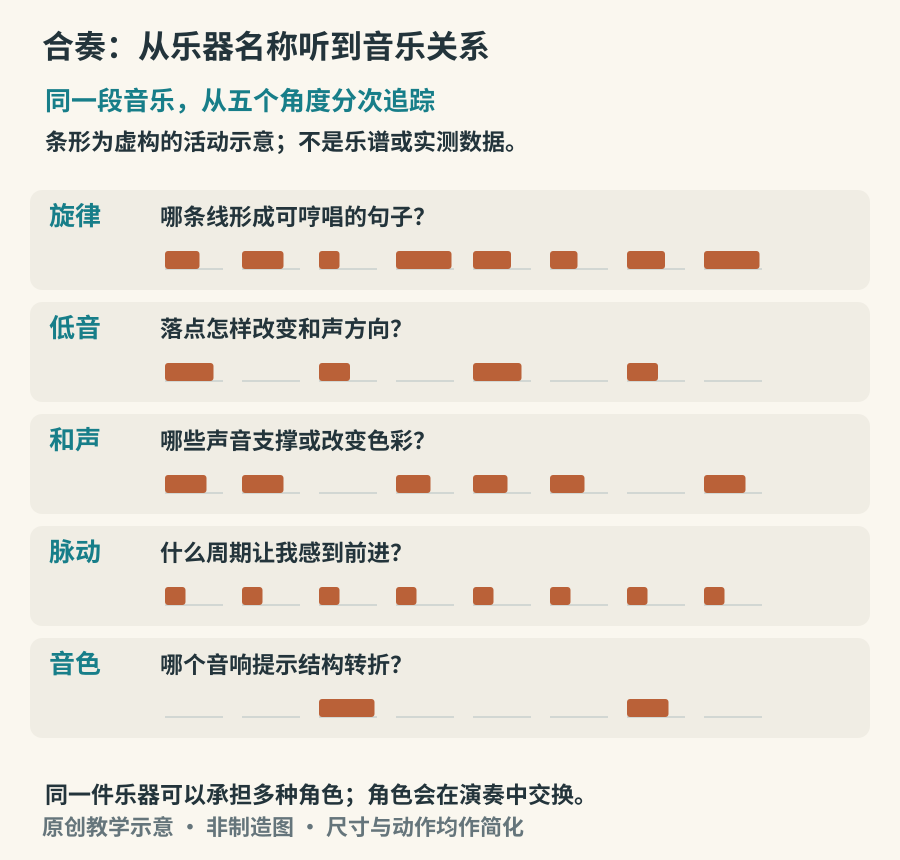

# 合奏：乐器怎样相互留下空间

独奏时，我们容易跟着一个声音走；合奏时，注意力会被旋律吸引，其他声部像背景一样退后。可是音乐的推进，常常来自不显眼的配合：低音提前一步，鼓把重音留空，伴奏在旋律换气时接上一个短句。认识乐器以后，还需要学会听它此刻在做什么。

## 把角色当作会移动的位置

旋律、低音、和声、节奏与音色，是观察合奏的几个入口，不是分配给乐器的永久职位。大提琴可以唱旋律，长笛可以形成和声背景，鼓也可以独奏。判断角色时，不妨先问：哪条线最像一句话？什么声音让我知道脉搏在哪里？哪些音让和声方向改变？

*图 17-1　原创聆听关系图。条形是虚构的活动示意，并非某首作品的测量结果。它描述可重叠的功能，不代表任何乐队的固定座次，也不表示所有音乐必须具备完整五项。*

“伴奏”也不是没有主动性。一个简单和弦可以提早、延后、加重或省略，改变旋律的语气。低音可以与鼓同落，也可以刻意错开。听合奏最有效的办法之一，就是在重复播放同一段时更换追踪对象，而不是不断换新曲目。

## 交响乐团：人数不是唯一答案

现代交响乐团常见弦乐、木管、铜管与打击乐声部，并随作品加入竖琴、键盘或其他乐器。大量同类弦乐共同演奏，能形成细节略有差别而整体融合的音响；管乐和打击乐则常以不同数量、音色和音量能力进入编配。具体座次、人数与乐器设置并没有跨时代的唯一标准。

布里顿《青少年管弦乐队指南》是很好的听辨入口。作品先后突出不同乐器，再将它们重新组织到合奏中；它不是一份音色测试题，主题的变化和最后的声部叠加同样值得听。可以先听某件乐器登场的几句，再在全奏中寻找它。[资料：LA Phil《The Young Person’s Guide to the Orchestra, Op. 34》](https://www.laphil.com/works/the-young-persons-guide-to-the-orchestra-op-34)

若想把视频与声音结合，伦敦交响乐团的教育资源提供对乐器与乐团组成的介绍。观看时，先把手的位置、吹奏动作与听到的起音对应起来；下一遍关掉画面，检验是否仍能追踪那个声部。[资料：London Symphony Orchestra《How to Build an Orchestra》](https://www.lso.co.uk/learn-and-discover/digital-activities-and-resources/how-to-build-an-orchestra/)

## 室内乐：每一个人都在转弯处回应

弦乐四重奏常由两把小提琴、中提琴与大提琴组成，但“室内乐”远不止这种编制。它的重要听觉特点之一，是可以更直接地追踪各条声部之间的联系。一件乐器提出短句，另一件接续、模仿或改变，第三件保持脉动，低音乐器重新安排落点。

第一次听四重奏，可以只画四条横线，在听见明显交接处做标记。无需先知道全部音名，也能看见“主题正在换人”。当四件乐器同时活动时，先选定低音；当低音稳定后，再把注意力移到上方。不要把自己暂时无法同时听清全部声部，当作理解失败。

## 丝竹与现代民族管弦乐

江南丝竹常以弦乐与吹管乐器共同呈现旋律，通过加花、繁简变化与相互让路形成层次。多个声部围绕相关旋律展开，并不等于大家逐音齐奏，也不必用西方四部和声的分工来解释所有关系。[资料：中国非物质文化遗产网“江南丝竹”](https://www.ihchina.cn/project_details/12529)

以《欢乐歌》为例，可先辨认笛子的连贯旋律，再听弹拨或击弦声如何把句子划分得更细。两条线偶尔分开又会合，是很有价值的观察。中国艺术研究院保存的江南丝竹历史音响资料，也提醒我们：同一曲名可能有不同录制年代、演奏群体和版本，不能拿单一现代演出当作全部传统的标准。[资料：中国艺术研究院艺术与文献馆《江南丝竹（共9首）》](https://lib.zgysyjy.org.cn/ting_detail/596857.html)

现代民族管弦乐团会以不同规模组织吹管、拉弦、弹拨与打击乐，并按照具体作品选择乐器。它与地方性小合奏既有联系，也有不同的编配、音量与舞台需求。所谓“民族乐器”包含许多地方传统，不能被一支大型乐团完全代表。

## 爵士与摇滚：脉动由谁建立

常见爵士小组合中，钢琴、低音与鼓构成节奏组，既提供支持，也能参与独奏与即兴回应。这里的节奏不是鼓一个人的任务：低音的时值、钢琴和弦出现的时机、旋律的切分，都在改变推进感。[资料：Herbie Hancock Institute《Jazz in America》，节奏组课程](https://www.jazzinamerica.org/LessonPlan/8/3/204)

听一段稳定的爵士演奏，可以先跟着贝斯轻点脚，再关注镲的周期，最后听钢琴怎样在空隙中加入和弦。不要把摇摆感概括成一个固定的长短比例；实际演奏还包含速度、重音、连断和乐手间的时间关系。音乐学院的即兴合奏指导也强调根据风格和其他成员调整音量与角色。[资料：Elon University《Jam Session Etiquette for Rhythm Section》](https://www.elon.edu/u/academics/arts-and-sciences/jazz-studies/jam-session-etiquette-for-rhythm-section/)

摇滚组合常把电吉他、电贝斯、架子鼓与人声放在核心位置，但键盘、采样、铜管和其他乐器也可能加入。听电吉他时，分清它是在弹和弦节奏型、重复短句还是旋律；听贝斯时，不只找最低音，还要看它与底鼓如何咬合。失真会改变频谱密度，因此两个乐器即使音符不同，也可能在相近音区互相遮挡。

## 甘美兰：一套乐器也是共同的调律世界

印度尼西亚甘美兰包含多种地方传统与编制，常见金属音条、锣、排锣、鼓，也可有弦乐、竹笛及人声。不能把它简化成“许多锣一起响”，也不能把爪哇、巴厘与其他地区的实践视为完全相同。乐器之间的调律、层级和节奏组织，是聆听的重要线索。[资料：UNESCO《Gamelan》](https://ich.unesco.org/en/RL/gamelan-01607)

初听时可追踪两件事：较长周期中反复出现的锣声，以及其间较密集的音型。先找到回归点，再听各层怎样嵌入循环。不同传统的调律与乐器配套方式不完全相同，不宜把任何音符都强行对准钢琴键，也不能假定来自两套乐器的同名音天然一致。[旁读：新加坡国家文物局《Gamelan Music》](https://www.roots.gov.sg/ich-landing/ich/gamelan-music)

## 三遍完成一次合奏观察

第一遍听整体，只写下哪里紧张、哪里放松；第二遍追踪一件低音乐器或周期标记；第三遍追踪旋律与其他声部的交接。把记录放在一起，试着解释整体感受是怎样形成的。

这个方法不要求先认出每一件乐器。真正的进步，是从“这里很热闹”走到“低音持续，旋律变密，打击声增加了新的重音”。当关系变得具体，乐器名才会从知识清单变成能用于聆听的工具。
