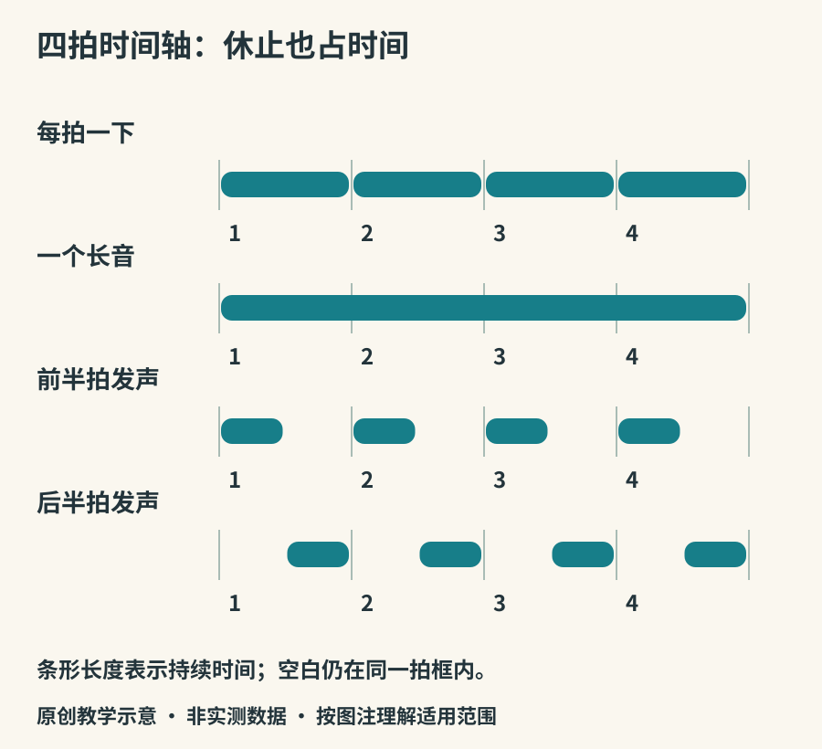

# 读谱、节拍与调律

谱子把音乐中某些关系记下来，却不会替演奏者完成声音。看懂一个音的名字，不等于知道它该以多轻的起音、怎样的呼吸、什么样的句尾出现。本章只建立够用的坐标，方便你接近教材和演奏，不把各种音乐传统压成一套唯一记法。

## 音高在什么位置

五线谱用线与间表示位置，谱号说明这些位置对应什么音。高音谱号、低音谱号不是“高档”和“低档”的区别；它们帮助不同音区减少过多加线。升降号表示相对基础音名的变化。实际发声还可能受八度记号与移调乐器惯例影响，因此不能看到谱上的C，就断定所有乐器会发出同一实际音高。

简谱用1至7标记基本音级，“1=C”说明1对应C音；1不一定是曲子的主音，例如以6为主音的小调记法。音符上下的点用于标示相对八度。吉他六线谱主要告诉你在哪根弦、哪个品位演奏，标准记谱则更直接呈现音高与时值。古琴减字谱又包含弦序、徽位和指法信息。不同记谱各有强项，也会省略不同细节。五线谱的入门路径可见[开放大学音高与记谱课程](https://www.open.edu/openlearn/history-the-arts/introduction-music-theory-2-pitch-and-notation)。

*图18：原创时间轴。以四分音符为一拍，只展示相对时值和细分；不替代完整谱表，也不表示所有音乐都按四拍组织。*

## 拍子是参照，节奏是安排

拍子像持续走动的参照点；节奏则包括声音何时进入、持续多久、在哪里休止。一个长音可以跨过多拍，一拍也能分成两个、三个或更多时值。BPM表示每分钟多少拍，但要结合指定的拍单位理解。[Ableton的节拍与速度说明](https://learningmusic.ableton.com/make-beats/beat-and-tempo.html)提供了可以边听边修改的示例。

4/4通常表示每小节包含四个四分音符的总时值，常按四拍感受。6/8每小节包含六个八分音符的总时值，常以两个附点四分音符大拍组织。它并不只是“比3/4多一倍”的写法：在同样六个八分音符下，三组两个与两组三个的重音组织不同。演奏时需结合速度、乐句与风格，不能只机械数分子。

休止也占时间。初学者容易把没发声的地方压短，导致下一次进入提前。练习时可以在休止位置做无声动作，让手臂或呼吸仍保持时间感，再逐步减少辅助动作。

## 音程是一种关系

在十二平均律中，一个八度的频率比为2:1，分成十二个相等的频率比，每半音的比值是2的十二次方根。相等的是比例，不是相邻频率都相差同样多少赫兹。因此从220到440 Hz是一个八度，从440到880 Hz也一样。音分用来描述比例大小，平均律一个半音为100音分，参见[佐治亚州立大学HyperPhysics](https://www.hyperphysics.phy-astr.gsu.edu/hbase/Music/etsum.html)。

现实演奏不必永远逐点贴着平均律。持续和弦中，演奏者可能调整某个音以配合其他声部；有些乐器与传统采用不同的音高组织。平均律的便利在于固定音高乐器可以较方便地跨调使用，不代表它是全部音乐的自然终点。[UNSW的律制与差音导论](https://www.phys.unsw.edu.au/jw/tartini-temperament.html)解释了纯律比例和平均律之间的差别。

## 调准一个音，还没有调准整首

两个人先对一个参照音，只是建立共同起点。管乐温度与吹奏、弦乐按弦位置、和弦中的声部关系，还会继续影响音准。UNSW的[木管调音说明](https://phys.unsw.edu.au/jw/tuning.html)强调在实际演奏音区与和弦中继续听与调整。

可以用本书`03-beating.wav`听两个接近频率的声音叠加后出现的缓慢强弱起伏，即拍频。听见起伏变慢，说明两个简单频率更接近；但没有其他信息时，拍频本身不能告诉你自己的音偏高还是偏低。这里的“拍频”与音乐的“节拍”同字不同义。

第一次看谱，不妨只寻找三件事：什么时候开始，什么时候换音，什么时候停。等声音和记号建立联系以后，再逐步加入力度、表情与更复杂的记法。
