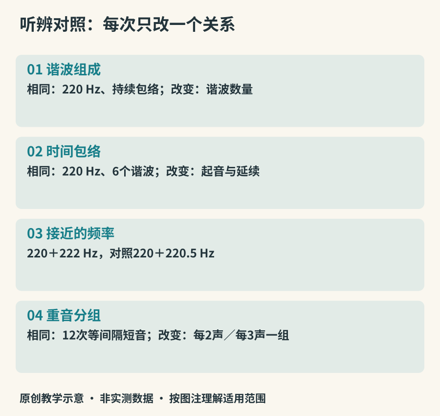

# 听辨实验室

熟悉一件乐器，不只是记住一个“典型音色”。音区变了、奏法变了、录音位置变了，原先的印象都可能失灵。本章把听辨拆成可以重复的小比较，并区分真正控制变量的合成实验与较接近现实的演奏观察。

## 实验一：同音高，不同组成

播放`assets/audio/01-harmonics.wav`，其中三个片段基频都为220 Hz，依次只含基频、含前四个整数倍成分、含前十个整数倍成分。每个片段间有短暂空白。先听是否仍有共同的音高中心，再比较明亮和粗糙的感觉。

这组声音控制了频率与数学包络，峰值进行了归一化。归一化不等于感知响度相同，听觉结果也不是对真实乐器的音色排名。关于频谱如何表示成分，可参看[UNSW频谱说明](https://www.phys.unsw.edu.au/jw/sound.spectrum.html)。

*图19：原创实验变量表。合成示例用于听关系，不提供真实乐器“标准音色”。*

## 实验二：留下声音的时间轮廓

播放`02-envelope.wav`。两段使用相同的谐波配方，前者快速进入后衰减，后者缓慢进入并维持一段时间。听起来可能让你联想到拨弦与持续音，但这只是联想。自然乐器的频谱与包络往往一起变化，无法仅靠这两段声音完成乐器识别。

现在回到真实录音，寻找一个被拉长的音和一个短音。它们来自同一乐器吗？同一演奏者是否用不同起音改变了你对声音“软硬”的感受？把注意力从名称转向变化，能避免“这个音不像印象里的小提琴，所以一定不是小提琴”的误判。

## 实验三：听近音的相遇

`03-beating.wav`先出现220与222 Hz叠加，再出现220与220.5 Hz叠加。每组起伏速度不同；不要把它听成演奏者在手动反复调音量。这是两个接近频率叠加的结果。复杂乐器有很多分音，真实调音中的拍会更复杂，简单模型只能示范一个基础关系。

## 实验四：节奏完全相同，重音不同

播放`04-grouping.wav`，两段都以相同间隔发出十二次短声。第一段按两个一组突出重音，第二段按三个一组。你可以边听边画竖线，记录自己自然分组的位置。强弱分组能影响拍感，但真实拍号不能只靠这一条线索决定，还要听旋律与和声等信息。

接着在[Ableton的节奏练习页](https://learningmusic.ableton.com/the-playground.html)改变鼓点位置，再保持节奏不变、只换发声部件。留意同一个节奏使用低音鼓或高频声部时，重心如何改变。网页需要网络，本书四段合成示例则可从工程包中离线播放。

## 实验五：真实演奏，保留不确定性

打开[大都会博物馆琵琶演奏页](https://www.metmuseum.org/art/collection/search/505247)，选一个含快速重复音的短片段。先只听，再观看其他可靠的演奏视频追踪右手。比较时分别写“听见的重复”与“看见的动作”，不要单凭连续音就断言采用了某一种具体轮指组合。

如果要比较小提琴与二胡、长笛与竹笛，应尽量寻找接近音区、相似速度和相同独奏条件的录音。完全无法控制条件时，也可以比较，但结论应限定为“这两份演奏的不同”，不能扩大成两种乐器永久不变的音色差异。

## 留下一张听辨记录

每次记录音源、时间位置、能确认的观察和仍待验证的原因。例如：“视频00:34出现连续滑动；画面中手指沿弦移动；不能确认是否有后期效果。”随着积累，你会形成自己的听觉词典，它由具体证据组成，而不是一串抽象赞美。

四个合成音频的参数与生成代码收在`scripts/make_audio.py`。它们既不是采样音色库，也没有复制现有作品。你可以修改一项参数后重听；如果同时改了很多项，就另开一条记录，避免失去比较基准。
