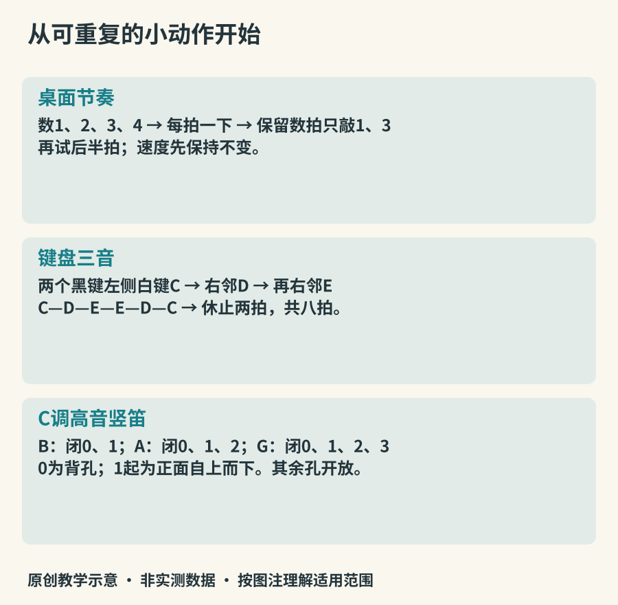

# 第一次演奏：三个小练习

第一次演奏的目标可以很小：让一个音重复出现得稳定，让两只手共享时间，或者用三个音做出一句有开头和结尾的话。以下练习不以速度或曲目长度评判成果。先读与设备相符的一条，做完再回看自己到底控制了什么。

*图20：原创练习路线。键盘按实音列名，竖笛仅给B-A-G入门指法的阅读约定；不同制式与音区仍须核对本器指法表。*

## 练习一：桌面节奏，不购器材

把双手放松，用指腹在桌面轻点，或轻拍自己的大腿。以四个均匀的拍为一组，口里数“一、二、三、四”。第一轮每拍一下，第二轮只在第一与第三拍发声，口里仍把四拍数完。第三轮每拍分成两半，数“一和、二和、三和、四和”，只在“和”上轻点。

接着请一人一直保持四拍，你做第三轮。困难常出现在把细分误当成新速度：手一加密，整个拍子也跟着加快。遇到这种情况先回到每拍一下，再用更慢速度细分。最后录下两轮，听后半段有没有越来越急。这个练习主要训练时间与协调，不等同于学会架子鼓或某种传统鼓法。

进阶时可在[Ableton的节奏工具](https://learningmusic.ableton.com/make-beats/make-beats)中安排相同位置，再听机械稳定的脉冲与自己的演奏差异。不要把所有细小差异都视为错误；先分清自己想要的安排与无意漂移。

## 练习二：键盘上的三个音

用钢琴、电钢琴或可发声的软件键盘。找到一组两个黑键，其左侧紧邻的白键是C；向右相邻两个白键依次是D、E。选择键盘中部，先依次弹C—D—E，每个音一拍，再弹E—D—C，每个音一拍，最后休止两拍。六个一拍音加两拍休止，整句共八拍；完整重复一次则共十六拍。

先用一只舒适的手指逐个找音，等位置明确后，再尝试右手拇指、食指、中指对应三个键。让手腕处在自然位置，不用固定的僵硬手型逼自己。这里只是一段找音练习，不替代钢琴技术训练，也不要求用同一指法迁移到所有旋律。

第二遍保持音符位置和节奏，只让最后一个C更轻，听结尾是否像“说完一句话”。第三次练习把八拍句连续奏两遍，前一遍略轻，后一遍略响。使用没有力度响应的软件键盘时，可能听不出触键强弱差别，应把比较改成音符长短，别误以为自己动作失败。可继续使用[Ableton音符与音阶实验](https://learningmusic.ableton.com/notes-and-scales/play-with-notes-and-scales.html)探索音高排列。

## 练习三：高音竖笛的B、A、G

如果有C调高音竖笛，先核对随器指法表。这里把背面的拇指孔记为0，正面从上到下依次为1至7；“闭”表示指腹完全盖住对应孔，未列出的孔保持开放。

| 音  | 需要关闭的孔 | 先检查什么               |
|-----|--------------|--------------------------|
| B   | 0、1         | 拇指孔与食指孔是否漏气   |
| A   | 0、1、2      | 加中指后前面手指是否抬起 |
| G   | 0、1、2、3   | 无名指是否正好盖住孔     |

左手在上，右手拇指轻托，嘴唇自然包住吹嘴，不要咬。用轻柔连续的气流试B音，再以轻说“嘟”的动作分开几次起音。若尖叫或跳高音，先检查是否气流过强、孔是否漏气；别马上更用力吹。雅马哈的[竖笛演奏页](https://www.yamaha.com/en/musical_instrument_guide/recorder/play/)有持法、指法与发声示范。

按B—A—G—休止，每项一拍，重复两次。熟悉后换成G—A—B—休止。巴洛克式与德式竖笛在更多音的指法上有差异，不能把这三个音的共同起点误当成全套指法相同，参见[制式说明](https://www.yamaha.com/en/musical_instrument_guide/recorder/selection/selection002.html)。

## 做完以后，留下能复现的结果

选择最顺利的一轮，录下十至二十秒，记录使用的乐器、速度和一个问题。下次先复现同一轮，再增加一个变化。结果可以是“休止没有抢”“G音比上次稳定”“最后一个音能轻一点”，无需一开始就追求完整曲目。

短练习的意义在于建立动作与听觉之间的反馈。当你能听见自己想改变的东西，下一次练习就有了清楚方向。
