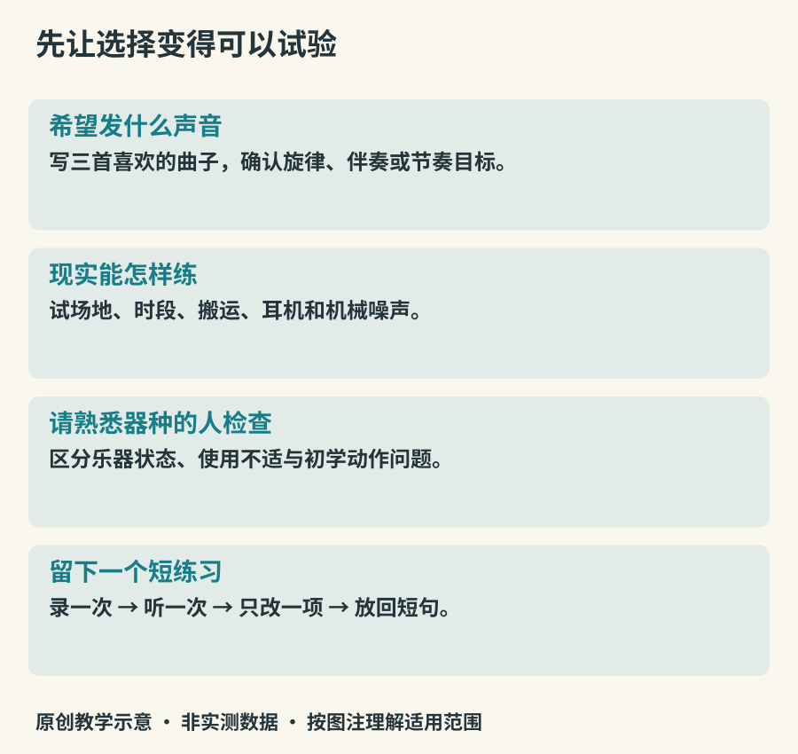

# 选择、练习与照顾乐器

认识许多乐器以后，可能会想选一种亲手学习。选择不必从“哪种最有前途”开始，可以先问：我希望经常发出什么声音，想独奏还是与人一起，现实生活允许我每天怎样练习。爱听的音色、可持续的时间与可接近的教学资源，往往比一张抽象的难度排行榜更有帮助。

## 把愿望放进实际生活

先写三首自己愿意反复听的曲子，找出喜欢的是旋律音色、和弦伴奏还是节奏互动。再列练习场所、搬运条件和可以持续使用的时段。电子乐器的耳机能减少外放声音，却仍可能有键盘、踏板或鼓垫的机械声；声学乐器加弱音装置也会改变手感与声音。最好在实际条件下试用。

本书不提供按价格排列的购买清单。品牌、市场与课程条件会变化，个体乐器状态也不同。真正试器时，可以请熟悉该器种的教师或技师检查，并让同一人用相同片段比较。先明确用途与可接受条件，购买才比较容易判断。

*图21：原创选择与练习流程。每一步都可以返回调整，不是决定天赋的测试。*

## 试器时听什么、摸什么

先检查舒适与基本工作状态，再谈音色喜好。手是否勉强够到，肩颈是否需要长期扭转，常用音是否顺畅，按键和接缝是否有异常。弦乐器要区分演奏者技术问题与弦高、装配等问题；管乐出现某个音难吹，也可能与漏气、簧片或气息有关，不能只凭初学者一次试吹判定。

雅马哈的[小提琴选用说明](https://www.yamaha.com/en/musical_instrument_guide/violin/selection/)提醒，同类乐器之间也会存在个体差异。对兴趣读者而言，较有价值的试用结果是“我知道自己在比较什么”，不是当场学会判断所有制作细节。

## 练习是一段反馈过程

先定一个可听见的小目标，例如四个音音量均匀。慢速演奏一次，停下来听，再决定改什么。若总是在某个换指处出错，就把那个连接单独抽出来，而不是从头不断冲过同一问题。最后回到短句，检查局部改善有没有留在音乐里。

可以把一段短练习分为回顾、单项、连接和自由演奏四部分，时长按自己的精力安排。本书的这个安排是组织练习的示例，不是经过实验确立的最佳分钟配方。录音只保留少量有代表性的片段，便于隔几天比较。

合奏时再增加一个目标：明确自己要听谁。低音与鼓可能需要共同稳定进入；旋律与伴奏要协调呼吸和收尾。先一起把一句结束，常常比谁都弹得更多更能改善合奏。

## 日常照顾按乐器区别处理

木质乐器对温湿度的急剧变化较敏感。不要长时间放在曝晒车厢、暖气旁或空调直吹处。吉他的[存放与环境说明](https://www.yamaha.com/en/musical_instrument_guide/acoustic_guitar/maintenance/maintenance002.html)强调环境稳定的重要性；具体范围应以对应型号说明和当地技师建议为准，不能把一种器材的标准照搬到所有乐器。

拉弦乐器演奏后可用合适的柔软干布清除表面汗渍与松香粉，避免随意使用家用清洁剂；弓在存放前按教学要求放松。参见[小提琴日常保养](https://www.yamaha.com/en/musical_instrument_guide/violin/maintenance/)。管乐的水分、簧片和连接部位需要分别照顾，金属与木质部件的处理也不同；不要把“能擦干净”理解成可以整件浸水。

钢琴的调律、机械调整与键盘表面清洁是不同工作。雅马哈的[钢琴保养说明](https://www.yamaha.com/en/musical_instrument_guide/piano/maintenance/)把日常可做的维护与专业处理分开。出现琴桥、琴体、按键机构或电路异常，应请专业人员判断，别让一本通识书替代维修手册。

## 进步不总是更快更响

更轻的起音、更稳定的慢速、听见伙伴后主动留白，都可能是进步。偶尔重听第一次录音，确认自己已能控制哪些细节，再选下一项小目标。乐器学习不是证明自己适合某个标签，而是逐步把听到的意图变成可重复的动作。
