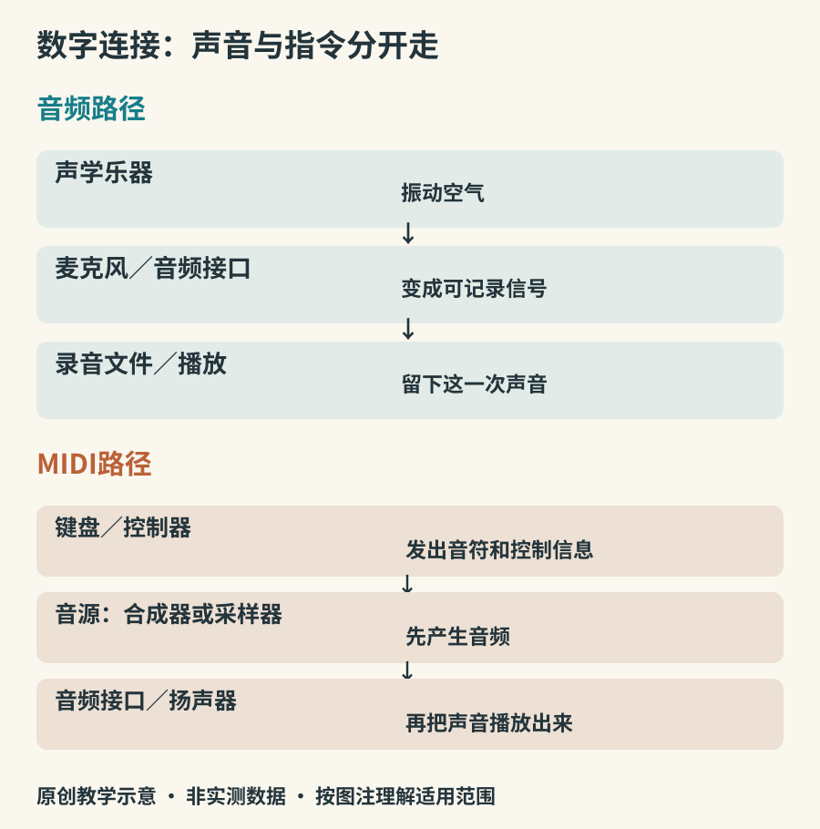

# 录音、数字连接与小制作

手机录下的声音与现场听到的不同，并不一定是乐器出了问题。麦克风的位置、房间反射、自动增益和扬声器都会参与。理解这条路径，可以帮助你用手边设备留下更有用的练习记录，也能分清数字乐器的“演奏信息”和“真正的声音”。

## 一次只移动麦克风

选一个安静房间，用同一段短乐句、尽量相同力度录三次。第一遍保持一个舒服的中等距离，第二遍稍近，第三遍稍远。记录位置，不要求预先套用某个万能厘米数。近距离往往较突出局部细节，远距离可能得到更多房间声，具体变化取决于声源辐射和麦克风特性。

舒尔的[录音麦克风技术指南](https://www.shure.com/en-US/docs/education/Microphone-Techniques-for-Recording)介绍了摆位、房间与音色平衡的关系。某些指向性麦克风靠近声源时会有近讲效应，使低频增强；不能把它概括成所有麦克风、所有手机都一定如此。录音时先避免过载，再比较位置，比先购买大量处理插件更容易看出问题来源。

*图22：原创信号链。MIDI一路需先经音源产生音频；“USB”只是可能的连接方式，并不保证所有设备同时传送两类数据。*

## 削波为什么会误导练习

数字录音有可表示的幅度上限。超过上限或在前端过载，可能产生明显失真。若只有最强的音听起来破碎，先降低输入增益或增加合适距离，再录一遍。自动电平处理会让弱音被抬高、强音被压低，不能仅凭处理后的录音判断自己的动态范围。是否可关闭自动处理，需要查具体设备说明。

保留一个未经进一步效果处理的版本，并记下设备与位置。下一次如果换了房间、手机模式和距离，就不宜把全部差异都归因于自己技术变化。录音是观察工具，条件写清楚，工具才可靠。

## MIDI记录的是怎么演奏

MIDI可以传递音符、力度、控制等信息，并不是那次演奏产生的音频。把同一段MIDI送给不同音源，可以得到完全不同的音色。[MIDI Association入门说明](https://midi.org/about-midi-part-1overview)把它解释为演奏指令，而非数字录音。力度数值也不保证任何音源都有相同响度响应。

因此，键盘连上电脑以后“有数据但没声音”，可能是尚未分配音源、监听或音频输出，并不一定是键盘损坏。设备如果同时提供USB音频和MIDI，应区分两个功能；只有MIDI接口的控制键盘，不能靠一根数据线自动变成带扬声器的电钢琴。

## 一个可以亲手完成的小制作

准备三个不易破碎、没有锐边的硬纸盒或塑料盒，以及柔软指腹；避免使用易裂玻璃和拉得过紧的金属丝。先轻敲三个物体，选出听感差别明显的两只。只比较轻敲中心与边缘，不额外填水、钻孔或改装。听到的变化可能包含振动模式、接触方式和支撑条件，不能单凭“盒子更大”推导普遍音高规律。

把两个声音记为A、B，演奏“A—A—B—休止”四拍型。录下后，改奏“A—B—A—休止”，把B移到第二拍，比较重心。这个小制作把器物变成了一个有控制的发声系统；它不等同于制作出具有稳定调律的专业打击乐器。

想做更可重复的实验，可运行`scripts/make_audio.py`。脚本只用Python标准库生成四份WAV，参数明确，适合修改基频、谐波数和时间包络。它演示的是数学模型，真实制作乐器仍涉及材料、结构与可奏性。

## 回到听的能力

读到这里，你已经能沿着一条完整路径追问：能量怎样输入，哪里振动，怎样选音，声音如何传到房间，又如何被记录。接下来可以选一个器种深入，也可以继续以听众的身份探索。具体听见一个声音怎样开始、变化和结束，就是这些知识最直接的用途。
