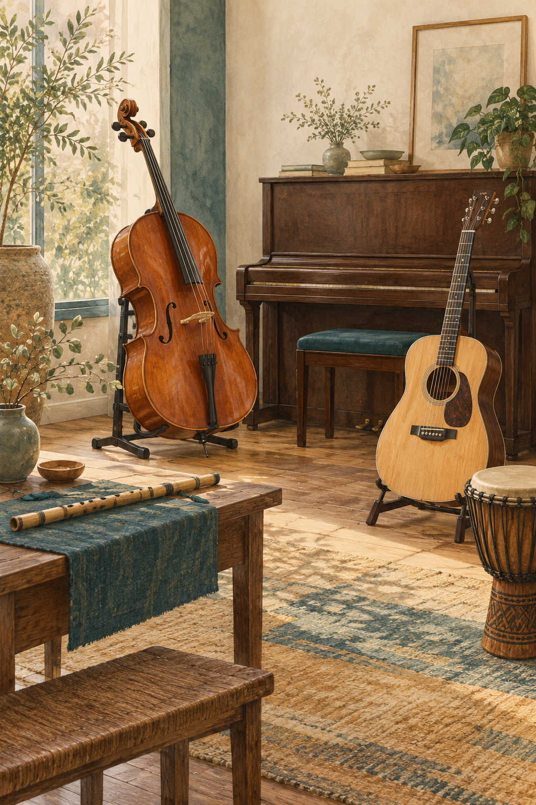

# 导读

*AI生成的现代情境插画，用于阅读导入；不是实物照片、精确结构图或历史复原。结构与动作请参看各章图解和资料。*

《听见乐器》写给对声音感兴趣、尚未接受专业音乐训练的读者。从一个音怎样出现开始，解释共同原理，比较不同家族与演奏传统，再进入听辨、合奏、初次演奏和录音。

你不必先买乐器，也不必读懂全部乐谱。观察大多可以用耳朵、演奏影像和简单动作完成。第20章另给桌面节奏、键盘三音与竖笛练习；这些是具体入口，不替代器种教材或技术指导。

全书按学习逻辑编排，不把文化地区当作乐器等级，也不把一种现代型号当作所有历史形制。乐器名称、发声分类、演奏接口与乐队角色分别讲清。世界乐器极其丰富，本书覆盖主要发声方法与代表案例，不声称列全所有地方传统。

图解说明关系及简化边界；实物、演奏与历史信息在相关段落旁给出机构或研究链接。四段离线试听是控制变量的合成模型，另有真实录音旁听入口，两者不混为证据。

第一版，2026年10月25日。可先顺读，也可从感兴趣的乐器章开始，再回到前四章。
